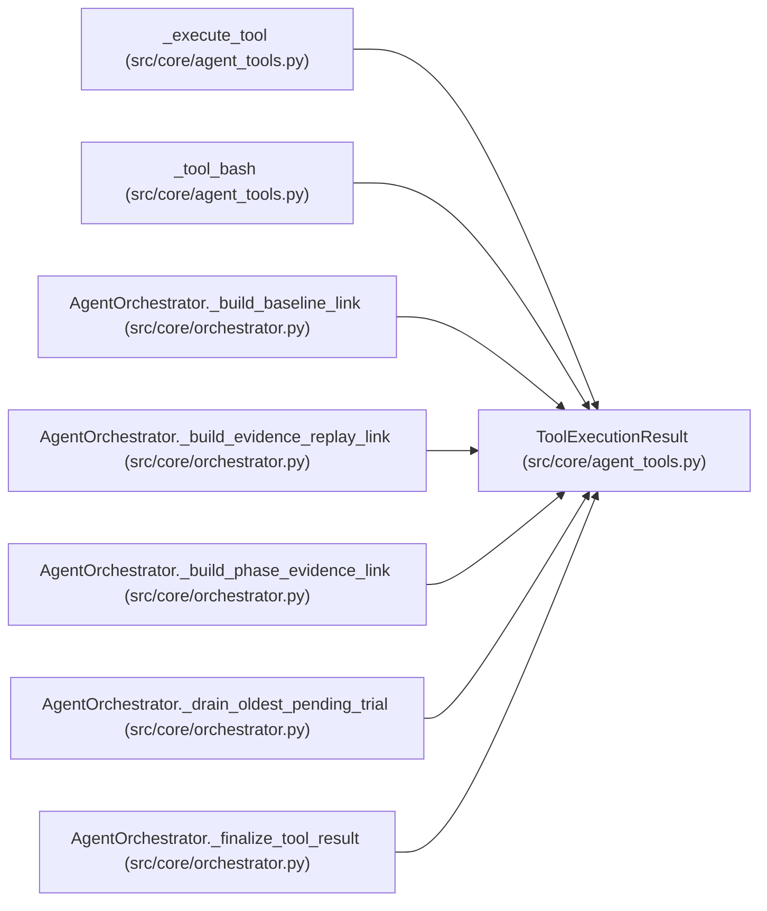

# ToolExecutionResult

**Location:** `src/core/agent_tools.py:45`
**Kind:** Class
**Bases:** —
**Module:** [agent_tools](../modules/agent_tools.md)

**Decorators:** `@dataclass(frozen=True)`

## Description

_Auto-generated from `ToolExecutionResult` in `src/core/agent_tools.py`._

## Attributes

| Name | Type | Default | Description |
|------|------|---------|-------------|
| `content` | `str` | *required* | — |
| `meta` | `Dict[str, Any]` | `field(default_factory=dict)` | — |

## Methods

*No public methods. Inherits from base classes.*

## Relationships

<!-- Auto-generated relationship summary. Do not edit by hand. -->

### Summary

| Module | Methods | Attributes |
|---|---:|---|
| [agent_tools](../modules/agent_tools.md) | 0 | `content`, `meta` |

### References

| Reference | Kind | Source | Call sites |
|---|---|---|---:|
| `_execute_tool` | call | [agent_tools](../modules/agent_tools.md) | 6 |
| `_execute_tool` | type_reference | [agent_tools](../modules/agent_tools.md) | — |
| `_tool_bash` | call | [agent_tools](../modules/agent_tools.md) | 1 |
| `_tool_bash` | type_reference | [agent_tools](../modules/agent_tools.md) | — |
| `AgentOrchestrator._build_baseline_link` | call | [orchestrator](../modules/orchestrator.md) | 1 |
| `AgentOrchestrator._build_baseline_link` | type_reference | [orchestrator](../modules/orchestrator.md) | — |
| `AgentOrchestrator._build_evidence_replay_link` | call | [orchestrator](../modules/orchestrator.md) | 1 |
| `AgentOrchestrator._build_evidence_replay_link` | type_reference | [orchestrator](../modules/orchestrator.md) | — |
| `AgentOrchestrator._build_phase_evidence_link` | call | [orchestrator](../modules/orchestrator.md) | 1 |
| `AgentOrchestrator._build_phase_evidence_link` | type_reference | [orchestrator](../modules/orchestrator.md) | — |
| `AgentOrchestrator._drain_oldest_pending_trial` | call | [orchestrator](../modules/orchestrator.md) | 1 |
| `AgentOrchestrator._finalize_tool_result` | type_reference | [orchestrator](../modules/orchestrator.md) | — |

> References: showing 12 of 14 logical references; 2 omitted by the 12-row generated summary limit.
