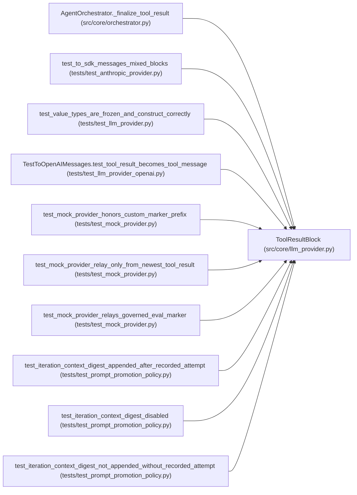

# ToolResultBlock

**Location:** `src/core/llm_provider.py:182`
**Kind:** Class
**Bases:** —
**Module:** [llm_provider](../modules/llm_provider.md)

**Decorators:** `@dataclass(frozen=True)`

## Description

A tool result fed back to the model by the loop (request-side block).

Matches the orchestrator's existing tool-result shape
(``{"type": "tool_result", "tool_use_id", "content": <str>}``).

## Attributes

| Name | Type | Default | Description |
|------|------|---------|-------------|
| `tool_use_id` | `str` | *required* | — |
| `content` | `str` | *required* | — |

## Methods

*No public methods. Inherits from base classes.*

## Relationships

<!-- Auto-generated relationship summary. Do not edit by hand. -->

### Summary

| Module | Methods | Attributes |
|---|---:|---|
| [llm_provider](../modules/llm_provider.md) | 0 | `content`, `tool_use_id` |

### References

| Reference | Kind | Source | Call sites |
|---|---|---|---:|
| `AgentOrchestrator._finalize_tool_result` | call | [orchestrator](../modules/orchestrator.md) | 2 |
| `test_to_sdk_messages_mixed_blocks` | call | [test_anthropic_provider](../modules/test_anthropic_provider.md) | 1 |
| `test_value_types_are_frozen_and_construct_correctly` | type_reference | [test_llm_provider](../modules/test_llm_provider.md) | — |
| `TestToOpenAIMessages.test_tool_result_becomes_tool_message` | call | [test_llm_provider_openai](../modules/test_llm_provider_openai.md) | 1 |
| `test_mock_provider_honors_custom_marker_prefix` | call | [test_mock_provider](../modules/test_mock_provider.md) | 1 |
| `test_mock_provider_relay_only_from_newest_tool_result` | call | [test_mock_provider](../modules/test_mock_provider.md) | 2 |
| `test_mock_provider_relays_governed_eval_marker` | call | [test_mock_provider](../modules/test_mock_provider.md) | 1 |
| `test_iteration_context_digest_appended_after_recorded_attempt` | call | [test_prompt_promotion_policy](../modules/test_prompt_promotion_policy.md) | 1 |
| `test_iteration_context_digest_disabled` | call | [test_prompt_promotion_policy](../modules/test_prompt_promotion_policy.md) | 1 |
| `test_iteration_context_digest_not_appended_without_recorded_attempt` | call | [test_prompt_promotion_policy](../modules/test_prompt_promotion_policy.md) | 1 |
