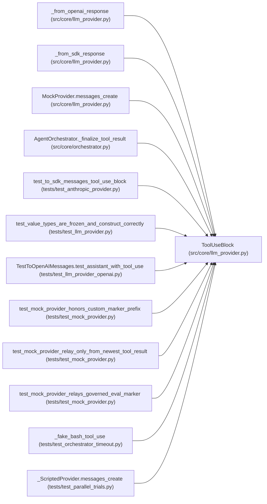

# ToolUseBlock

**Location:** `src/core/llm_provider.py:168`
**Kind:** Class
**Bases:** —
**Module:** [llm_provider](../modules/llm_provider.md)

**Decorators:** `@dataclass(frozen=True)`

## Description

A tool-call request emitted by the model (Anthropic-shaped).

``input`` is a ``dict``; OpenAI's JSON-string ``function.arguments`` is
parsed to a dict by the provider (malformed JSON fails closed as a tool
error, never crashing the loop).

## Attributes

| Name | Type | Default | Description |
|------|------|---------|-------------|
| `id` | `str` | *required* | — |
| `name` | `str` | *required* | — |
| `input` | `dict[str, Any]` | *required* | — |

## Methods

*No public methods. Inherits from base classes.*

## Relationships

<!-- Auto-generated relationship summary. Do not edit by hand. -->

### Summary

| Module | Methods | Attributes |
|---|---:|---|
| [llm_provider](../modules/llm_provider.md) | 0 | `id`, `input`, `name` |

### References

| Reference | Kind | Source | Call sites |
|---|---|---|---:|
| `_from_openai_response` | call | [llm_provider](../modules/llm_provider.md) | 1 |
| `_from_sdk_response` | call | [llm_provider](../modules/llm_provider.md) | 1 |
| `MockProvider.messages_create` | call | [llm_provider](../modules/llm_provider.md) | 2 |
| `AgentOrchestrator._finalize_tool_result` | type_reference | [orchestrator](../modules/orchestrator.md) | — |
| `test_to_sdk_messages_tool_use_block` | call | [test_anthropic_provider](../modules/test_anthropic_provider.md) | 1 |
| `test_value_types_are_frozen_and_construct_correctly` | type_reference | [test_llm_provider](../modules/test_llm_provider.md) | — |
| `TestToOpenAIMessages.test_assistant_with_tool_use` | call | [test_llm_provider_openai](../modules/test_llm_provider_openai.md) | 1 |
| `test_mock_provider_honors_custom_marker_prefix` | call | [test_mock_provider](../modules/test_mock_provider.md) | 1 |
| `test_mock_provider_relay_only_from_newest_tool_result` | call | [test_mock_provider](../modules/test_mock_provider.md) | 2 |
| `test_mock_provider_relays_governed_eval_marker` | call | [test_mock_provider](../modules/test_mock_provider.md) | 1 |
| `_fake_bash_tool_use` | call | [test_orchestrator_timeout](../modules/test_orchestrator_timeout.md) | 1 |
| `_ScriptedProvider.messages_create` | call | [test_parallel_trials](../modules/test_parallel_trials.md) | 1 |

> References: showing 12 of 13 logical references; 1 omitted by the 12-row generated summary limit.
