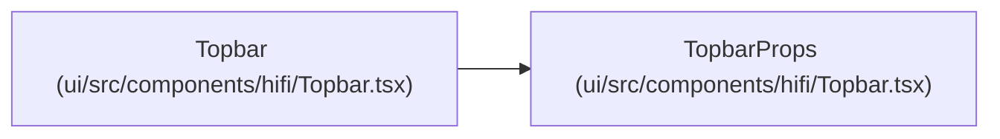

# TopbarProps

**Location:** `ui/src/components/hifi/Topbar.tsx:62`
**Kind:** Class
**Bases:** —
**Module:** [Topbar](../modules/Topbar.md)

## Description

_Auto-generated from `TopbarProps` in `ui/src/components/hifi/Topbar.tsx`._

## Attributes

| Name | Type | Required | Default | Description |
|------|------|----------|---------|-------------|
| `onToggleTheme` | `() => void` | No | — | — |
| `theme` | `ThemeName` | No | — | — |

## Methods

*No public methods. Inherits from base classes.*

## Relationships

<!-- Auto-generated relationship summary. Do not edit by hand. -->

### Summary

| Module | Methods | Attributes |
|---|---:|---|
| [Topbar](../modules/Topbar.md) | 0 | `onToggleTheme`, `theme` |

### References

| Reference | Kind | Source | Call sites |
|---|---|---|---:|
| `Topbar` | type_reference | [Topbar](../modules/Topbar.md) | — |
