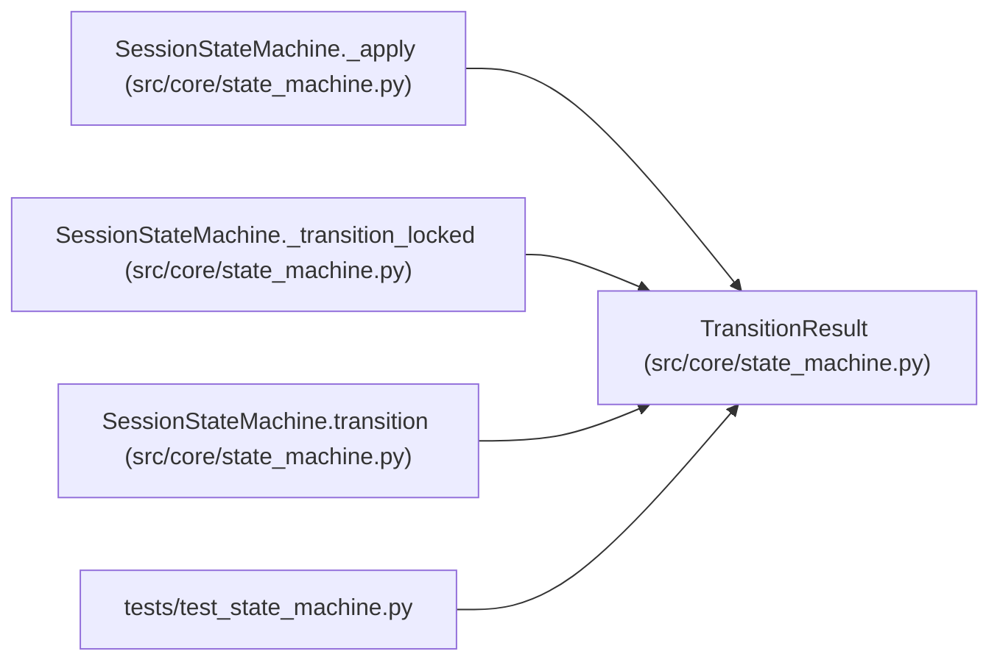

# TransitionResult

**Location:** `src/core/state_machine.py:142`
**Kind:** Class
**Bases:** —
**Module:** [state_machine](../modules/state_machine.md)

**Decorators:** `@dataclass(frozen=True)`

## Description

Outcome of a ``transition()`` call.

``changed`` is ``False`` for idempotent no-ops (replays against a terminal
state, ``(paused, pause)``, re-asserting the in-flight intent), which emit
no audit row and no broadcast (ARC-011 §7.2). ``should_auto_promote`` is
``True`` only for the net ``running -> completed`` completion and is the
caller's signal to fire auto-promotion as a post-commit side-effect (§4.3).

## Attributes

| Name | Type | Default | Description |
|------|------|---------|-------------|
| `new_state` | `SessionState` | *required* | — |
| `changed` | `bool` | *required* | — |
| `event` | `SessionEvent` | *required* | — |
| `from_state` | `SessionState` | *required* | — |
| `path` | `Tuple[SessionState, ...]` | `()` | — |
| `should_auto_promote` | `bool` | `False` | — |
| `broadcast_event` | `Optional[str]` | `None` | — |
| `severity_redirected` | `bool` | `False` | — |

## Methods

*No public methods. Inherits from base classes.*

## Relationships

<!-- Auto-generated relationship summary. Do not edit by hand. -->

### Summary

| Module | Methods | Attributes |
|---|---:|---|
| [state_machine](../modules/state_machine.md) | 0 | `broadcast_event`, `changed`, `event`, `from_state`, `new_state`, `path`, `severity_redirected`, `should_auto_promote` |

### References

| Reference | Kind | Source | Call sites |
|---|---|---|---:|
| `SessionStateMachine._apply` | call | [state_machine](../modules/state_machine.md) | 1 |
| `SessionStateMachine._apply` | type_reference | [state_machine](../modules/state_machine.md) | — |
| `SessionStateMachine._transition_locked` | call | [state_machine](../modules/state_machine.md) | 3 |
| `SessionStateMachine._transition_locked` | type_reference | [state_machine](../modules/state_machine.md) | — |
| `SessionStateMachine.transition` | type_reference | [state_machine](../modules/state_machine.md) | — |
| `test_state_machine` | import | [test_state_machine](../modules/test_state_machine.md) | — |
