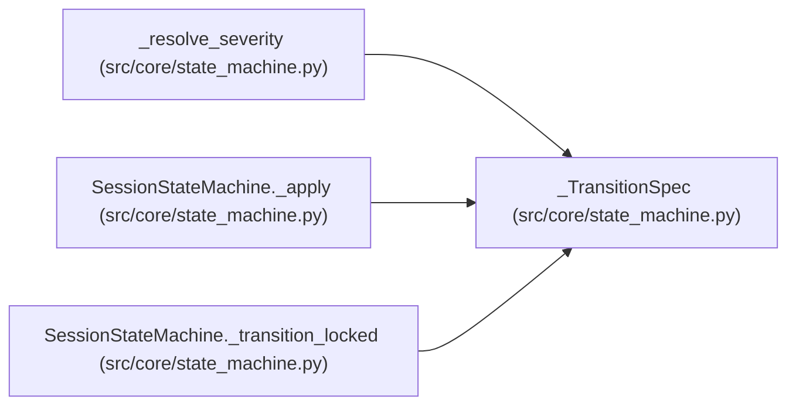

# _TransitionSpec

**Location:** `src/core/state_machine.py:164`
**Kind:** Class
**Bases:** —
**Module:** [state_machine](../modules/state_machine.md)

**Decorators:** `@dataclass(frozen=True)`

## Description

Declarative description of a transition's writes and side-effects.

``transitional`` is the optional intent state written before the terminal
state under the same lock (e.g. ``complete`` writes ``completing`` then
``completed``). ``broadcast_event`` is ``None`` for transitional-only steps
that must not be broadcast (ARC-011 §9). ``auto_promote`` is ``True`` only
for the net ``running -> completed`` completion.

## Attributes

| Name | Type | Default | Description |
|------|------|---------|-------------|
| `terminal` | `SessionState` | *required* | — |
| `transitional` | `Optional[SessionState]` | `None` | — |
| `broadcast_event` | `Optional[str]` | `None` | — |
| `auto_promote` | `bool` | `False` | — |

## Methods

*No public methods. Inherits from base classes.*

## Relationships

<!-- Auto-generated relationship summary. Do not edit by hand. -->

### Summary

| Module | Methods | Attributes |
|---|---:|---|
| [state_machine](../modules/state_machine.md) | 0 | `auto_promote`, `broadcast_event`, `terminal`, `transitional` |

### References

| Reference | Kind | Source | Call sites |
|---|---|---|---:|
| `_resolve_severity` | type_reference | [state_machine](../modules/state_machine.md) | — |
| `SessionStateMachine._apply` | type_reference | [state_machine](../modules/state_machine.md) | — |
| `SessionStateMachine._transition_locked` | call | [state_machine](../modules/state_machine.md) | 2 |
