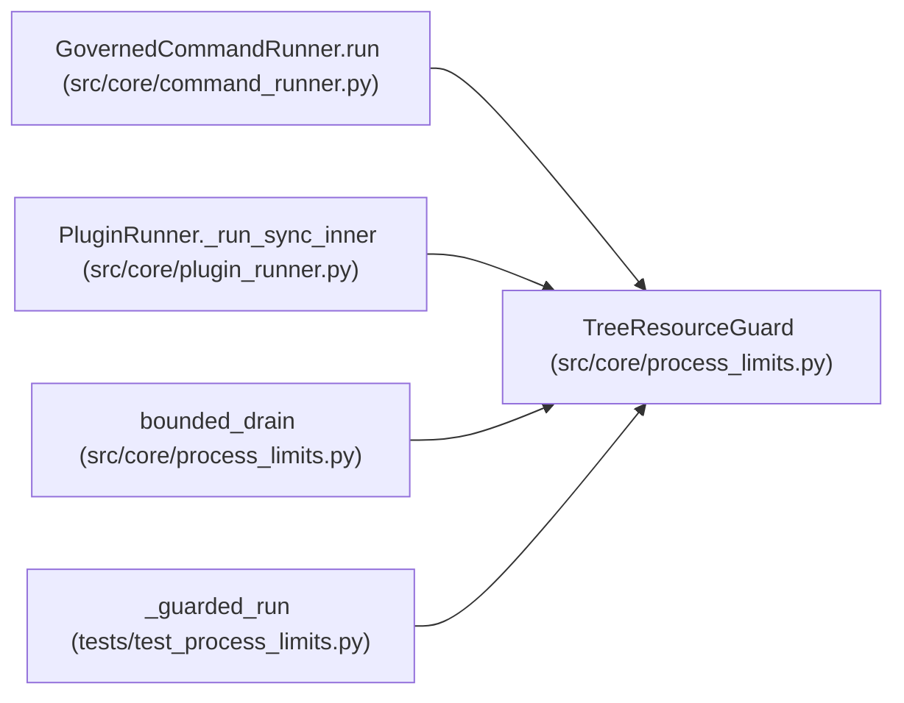

# TreeResourceGuard

**Location:** `src/core/process_limits.py:173`
**Kind:** Class
**Bases:** —
**Module:** [process_limits](../modules/process_limits.md)

## Description

Polls one subprocess tree and terminates it the moment a cap is breached.

Cumulative CPU is summed across the whole tree and compared against the
cap directly (never per-interval deltas); RSS is summed across the tree;
process count includes the root. On the first breach the guard terminates
the tree itself — there is no flag-for-later-check phase — and records the
attributed violation kind.

## Attributes

*No annotated attributes found.*

## Methods

| Method | Signature | Decorators | Description |
|--------|-----------|------------|-------------|
| `__init__` | `(proc: 'subprocess.Popen', caps: ProcessResourceCaps) -> None` | — | — |
| `start` | `() -> None` | — | — |
| `stop` | `() -> None` | — | — |
| `_record` | `(kind: str) -> None` | — | — |
| `_loop` | `() -> None` | — | — |

## Relationships

<!-- Auto-generated relationship summary. Do not edit by hand. -->

### Summary

| Module | Methods | Attributes |
|---|---:|---|
| [process_limits](../modules/process_limits.md) | 5 | — |

### References

| Reference | Kind | Source | Call sites |
|---|---|---|---:|
| `GovernedCommandRunner.run` | call | [command_runner](../modules/command_runner.md) | 1 |
| `PluginRunner._run_sync_inner` | call | [plugin_runner](../modules/plugin_runner.md) | 1 |
| `bounded_drain` | type_reference | [process_limits](../modules/process_limits.md) | — |
| `_guarded_run` | call | [test_process_limits](../modules/test_process_limits.md) | 1 |
