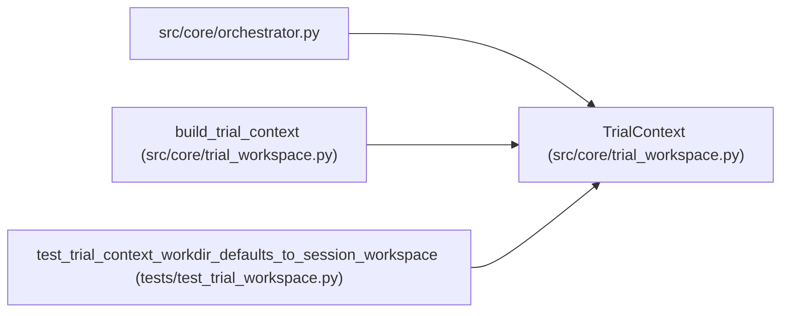

# TrialContext

**Location:** `src/core/trial_workspace.py:52`
**Kind:** Class
**Bases:** —
**Module:** [trial_workspace](../modules/trial_workspace.md)

**Decorators:** `@dataclass(frozen=True)`

## Description

Per-command execution context (P2 per-workdir state).

``trial_dir`` is ``None`` for the default sequential path — ``workdir``
then resolves to the session workspace and every consumer behaves
exactly as before the refactor.

## Attributes

| Name | Type | Default | Description |
|------|------|---------|-------------|
| `research_id` | `str` | *required* | — |
| `turn` | `int` | *required* | — |
| `seq` | `int` | *required* | — |
| `session_workspace` | `str` | *required* | — |
| `trial_dir` | `Optional[str]` | `None` | — |

## Methods

| Method | Signature | Decorators | Description |
|--------|-----------|------------|-------------|
| `workdir` | `() -> str` | `@property` | The directory the governed subprocess runs in. |
| `is_trial` | `() -> bool` | `@property` | — |

## Relationships

<!-- Auto-generated relationship summary. Do not edit by hand. -->

### Summary

| Module | Methods | Attributes |
|---|---:|---|
| [trial_workspace](../modules/trial_workspace.md) | 2 | `research_id`, `seq`, `session_workspace`, `trial_dir`, `turn` |

### References

| Reference | Kind | Source | Call sites |
|---|---|---|---:|
| `orchestrator` | import | [orchestrator](../modules/orchestrator.md) | — |
| `build_trial_context` | call | [trial_workspace](../modules/trial_workspace.md) | 1 |
| `build_trial_context` | type_reference | [trial_workspace](../modules/trial_workspace.md) | — |
| `test_trial_context_workdir_defaults_to_session_workspace` | call | [test_trial_workspace](../modules/test_trial_workspace.md) | 2 |
