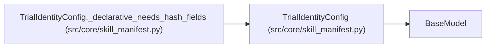

# TrialIdentityConfig

**Location:** `src/core/skill_manifest.py:829`
**Kind:** Pydantic model
**Bases:** `BaseModel`
**Module:** [skill_manifest](../modules/skill_manifest.md)

## Description

Dedup trial-identity contract (ARC-011 §9 ``trial_identity``, G2).
``hash_fields`` covers the declarative common case; ``resolve`` selects the
plugin for the multi-source synthesis.

## Model Configuration

| Setting | Value | Source |
|---------|-------|--------|
| `extra` | `'forbid'` | model_config |

## Validators

| Method | Scope | Fields | Mode | Options |
|--------|-------|--------|------|---------|
| `_declarative_needs_hash_fields` | model | — | after | — |

## Attributes

| Name | Type | Wire name | Required | Nullable | Default | Constraints | Examples | Description |
|------|------|-----------|----------|----------|---------|-------------|-------------|----------|
| `hash_fields` | `list[str]` | `hash_fields` | No | No | factory: `list` | — | — | — |
| `resolve` | `IdentityResolve` | `resolve` | No | No | factory: `lambda: IdentityResolve(mode='declarative')` | — | — | — |

## Methods

| Method | Signature | Decorators | Description |
|--------|-----------|------------|-------------|
| `_declarative_needs_hash_fields` | `() -> 'TrialIdentityConfig'` | `@model_validator(mode='after')` | — |

## Relationships

<!-- Auto-generated relationship summary. Do not edit by hand. -->

### Summary

| Module | Methods | Attributes |
|---|---:|---|
| [skill_manifest](../modules/skill_manifest.md) | 1 | `hash_fields`, `resolve` |

### Structure

| Kind | Entity | Module |
|---|---|---|
| Base | `BaseModel` | — |

### References

| Reference | Kind | Source | Call sites |
|---|---|---|---:|
| `TrialIdentityConfig._declarative_needs_hash_fields` | type_reference | [skill_manifest](../modules/skill_manifest.md) | — |
