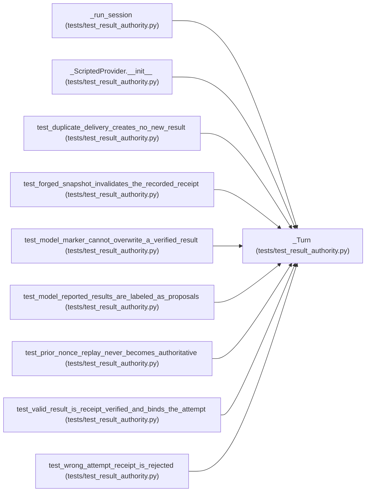

# _Turn

**Location:** `tests/test_result_authority.py:67`
**Kind:** Class
**Bases:** —
**Module:** [test_result_authority](../modules/test_result_authority.md)

## Description

One provider response: tool calls and/or assistant text.

## Attributes

*No annotated attributes found.*

## Methods

| Method | Signature | Decorators | Description |
|--------|-----------|------------|-------------|
| `__init__` | `(*, bash: list[str] \| None = None, text: str = '') -> None` | — | — |

## Relationships

<!-- Auto-generated relationship summary. Do not edit by hand. -->

### Summary

| Module | Methods | Attributes |
|---|---:|---|
| [test_result_authority](../modules/test_result_authority.md) | 1 | — |

### References

| Reference | Kind | Source | Call sites |
|---|---|---|---:|
| `_run_session` | type_reference | [test_result_authority](../modules/test_result_authority.md) | — |
| `_ScriptedProvider.__init__` | type_reference | [test_result_authority](../modules/test_result_authority.md) | — |
| `test_duplicate_delivery_creates_no_new_result` | call | [test_result_authority](../modules/test_result_authority.md) | 1 |
| `test_forged_snapshot_invalidates_the_recorded_receipt` | call | [test_result_authority](../modules/test_result_authority.md) | 1 |
| `test_model_marker_cannot_overwrite_a_verified_result` | call | [test_result_authority](../modules/test_result_authority.md) | 1 |
| `test_model_reported_results_are_labeled_as_proposals` | call | [test_result_authority](../modules/test_result_authority.md) | 2 |
| `test_prior_nonce_replay_never_becomes_authoritative` | call | [test_result_authority](../modules/test_result_authority.md) | 2 |
| `test_valid_result_is_receipt_verified_and_binds_the_attempt` | call | [test_result_authority](../modules/test_result_authority.md) | 1 |
| `test_wrong_attempt_receipt_is_rejected` | call | [test_result_authority](../modules/test_result_authority.md) | 2 |
