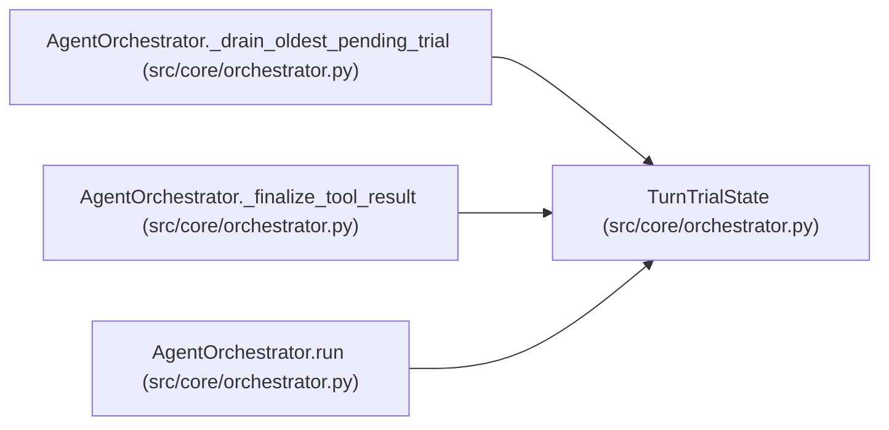

# TurnTrialState

**Location:** `src/core/orchestrator.py:273`
**Kind:** Class
**Bases:** —
**Module:** [orchestrator](../modules/orchestrator.md)

**Decorators:** `@dataclass`

## Description

Mutable per-turn execution state owned by the agent tool loop.

The sequential path mutates one instance inline (byte-identical behavior:
``results_by_index`` is assembled into ``tool_results`` in block order at
the end of the turn). The parallel path hands the same instance to each
deferred trial finalizer — the mutation *points* are identical, only the
execution of the subprocesses overlaps. ``results_by_index`` (not an
append-order list) is what keeps per-trial ``ToolResultBlock``s aligned
with their blocks when trials finish out of order.

## Attributes

| Name | Type | Default | Description |
|------|------|---------|-------------|
| `research_id` | `str` | *required* | — |
| `turn` | `int` | *required* | — |
| `workspace` | `str` | *required* | — |
| `iteration_count` | `int` | `0` | — |
| `duplicate_rejected_count` | `int` | `0` | — |
| `turn_recorded_iteration` | `bool` | `False` | — |
| `turn_ran_training_command` | `bool` | `False` | — |
| `policy_rejections_consecutive` | `int` | `0` | — |
| `policy_aborted` | `bool` | `False` | — |
| `results_by_index` | `Dict[int, RequestBlock]` | `field(default_factory=dict)` | — |
| `seen_primary_metrics` | `set` | `field(default_factory=set)` | — |

## Methods

*No public methods. Inherits from base classes.*

## Relationships

<!-- Auto-generated relationship summary. Do not edit by hand. -->

### Summary

| Module | Methods | Attributes |
|---|---:|---|
| [orchestrator](../modules/orchestrator.md) | 0 | `duplicate_rejected_count`, `iteration_count`, `policy_aborted`, `policy_rejections_consecutive`, `research_id`, `results_by_index`, `seen_primary_metrics`, `turn`, `turn_ran_training_command`, `turn_recorded_iteration`, `workspace` |

### References

| Reference | Kind | Source | Call sites |
|---|---|---|---:|
| `AgentOrchestrator._drain_oldest_pending_trial` | type_reference | [orchestrator](../modules/orchestrator.md) | — |
| `AgentOrchestrator._finalize_tool_result` | type_reference | [orchestrator](../modules/orchestrator.md) | — |
| `AgentOrchestrator.run` | call | [orchestrator](../modules/orchestrator.md) | 1 |
