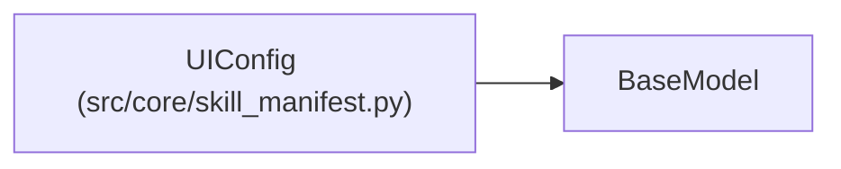

# UIConfig

**Location:** `src/core/skill_manifest.py:902`
**Kind:** Pydantic model
**Bases:** `BaseModel`
**Module:** [skill_manifest](../modules/skill_manifest.md)

## Description

UI hints (ARC-011 §9 ``ui``). Advisory; not behaviorally load-bearing.

## Model Configuration

| Setting | Value | Source |
|---------|-------|--------|
| `extra` | `'allow'` | model_config |

## Attributes

| Name | Type | Wire name | Required | Nullable | Default | Constraints | Examples | Description |
|------|------|-----------|----------|----------|---------|-------------|-------------|----------|
| `form_fields` | `list[dict[str, Any]]` | `form_fields` | No | No | factory: `list` | — | — | — |
| `chart` | `Optional[dict[str, Any]]` | `chart` | No | Yes | `None` | — | — | — |

## Methods

*No public methods. Inherits from base classes.*

## Relationships

<!-- Auto-generated relationship summary. Do not edit by hand. -->

### Summary

| Module | Methods | Attributes |
|---|---:|---|
| [skill_manifest](../modules/skill_manifest.md) | 0 | `chart`, `form_fields` |

### Structure

| Kind | Entity | Module |
|---|---|---|
| Base | `BaseModel` | — |
