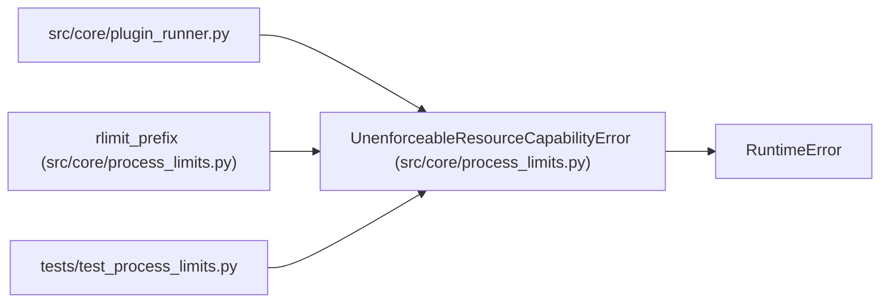

# UnenforceableResourceCapabilityError

**Location:** `src/core/process_limits.py:58`
**Kind:** Class
**Bases:** `RuntimeError`
**Module:** [process_limits](../modules/process_limits.md)

## Description

A configured resource cap cannot be enforced on this host (fail-closed).

## Attributes

*No annotated attributes found.*

## Methods

*No public methods. Inherits from base classes.*

## Relationships

<!-- Auto-generated relationship summary. Do not edit by hand. -->

### Summary

| Module | Methods | Attributes |
|---|---:|---|
| [process_limits](../modules/process_limits.md) | 0 | — |

### Structure

| Kind | Entity | Module |
|---|---|---|
| Base | `RuntimeError` | — |

### References

| Reference | Kind | Source | Call sites |
|---|---|---|---:|
| `plugin_runner` | import | [plugin_runner](../modules/plugin_runner.md) | — |
| `rlimit_prefix` | call | [process_limits](../modules/process_limits.md) | 1 |
| `test_process_limits` | import | [test_process_limits](../modules/test_process_limits.md) | — |
