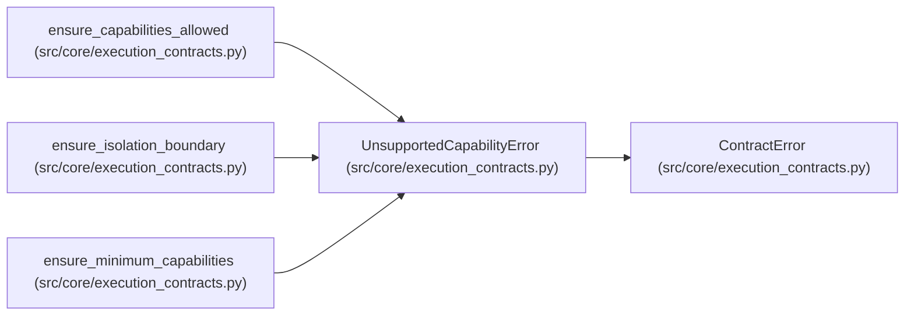

# UnsupportedCapabilityError

**Location:** `src/core/execution_contracts.py:105`
**Kind:** Class
**Bases:** `ContractError`
**Module:** [execution_contracts](../modules/execution_contracts.md)

## Description

Raised before work starts when a capability is unknown or unsupported.

Unknown or unsupported capabilities fail explicitly; nothing silently
falls back to weaker semantics.

## Attributes

*No annotated attributes found.*

## Methods

*No public methods. Inherits from base classes.*

## Relationships

<!-- Auto-generated relationship summary. Do not edit by hand. -->

### Summary

| Module | Methods | Attributes |
|---|---:|---|
| [execution_contracts](../modules/execution_contracts.md) | 0 | — |

### Structure

| Kind | Entity | Module |
|---|---|---|
| Base | `ContractError` | [execution_contracts](../modules/execution_contracts.md) |

### References

| Reference | Kind | Source | Call sites |
|---|---|---|---:|
| `ensure_capabilities_allowed` | call | [execution_contracts](../modules/execution_contracts.md) | 1 |
| `ensure_isolation_boundary` | call | [execution_contracts](../modules/execution_contracts.md) | 1 |
| `ensure_minimum_capabilities` | call | [execution_contracts](../modules/execution_contracts.md) | 1 |
