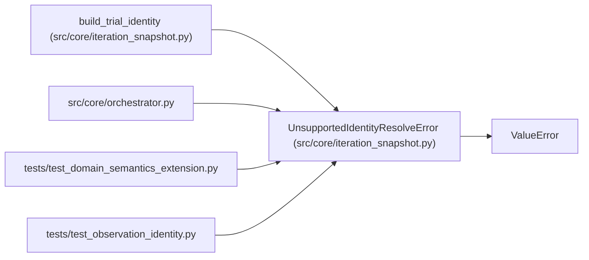

# UnsupportedIdentityResolveError

**Location:** `src/core/iteration_snapshot.py:53`
**Kind:** Class
**Bases:** `ValueError`
**Module:** [iteration_snapshot](../modules/iteration_snapshot.md)

## Description

Raised when an identity resolver mode is declared but unsupported.

## Attributes

*No annotated attributes found.*

## Methods

*No public methods. Inherits from base classes.*

## Relationships

<!-- Auto-generated relationship summary. Do not edit by hand. -->

### Summary

| Module | Methods | Attributes |
|---|---:|---|
| [iteration_snapshot](../modules/iteration_snapshot.md) | 0 | — |

### Structure

| Kind | Entity | Module |
|---|---|---|
| Base | `ValueError` | — |

### References

| Reference | Kind | Source | Call sites |
|---|---|---|---:|
| `build_trial_identity` | call | [iteration_snapshot](../modules/iteration_snapshot.md) | 1 |
| `orchestrator` | import | [orchestrator](../modules/orchestrator.md) | — |
| `test_domain_semantics_extension` | import | [test_domain_semantics_extension](../modules/test_domain_semantics_extension.md) | — |
| `test_observation_identity` | import | [test_observation_identity](../modules/test_observation_identity.md) | — |
