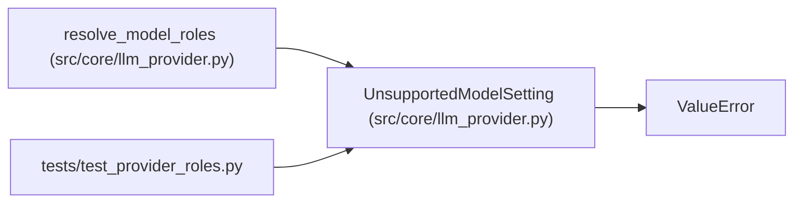

# UnsupportedModelSetting

**Location:** `src/core/llm_provider.py:1294`
**Kind:** Class
**Bases:** `ValueError`
**Module:** [llm_provider](../modules/llm_provider.md)

## Description

A provider/model role combination the runtime cannot serve.

Raised with an actionable diagnostic before any session side effect —
never worked around by silently selecting a different (paid) model.

## Attributes

*No annotated attributes found.*

## Methods

*No public methods. Inherits from base classes.*

## Relationships

<!-- Auto-generated relationship summary. Do not edit by hand. -->

### Summary

| Module | Methods | Attributes |
|---|---:|---|
| [llm_provider](../modules/llm_provider.md) | 0 | — |

### Structure

| Kind | Entity | Module |
|---|---|---|
| Base | `ValueError` | — |

### References

| Reference | Kind | Source | Call sites |
|---|---|---|---:|
| `resolve_model_roles` | call | [llm_provider](../modules/llm_provider.md) | 1 |
| `test_provider_roles` | import | [test_provider_roles](../modules/test_provider_roles.md) | — |
