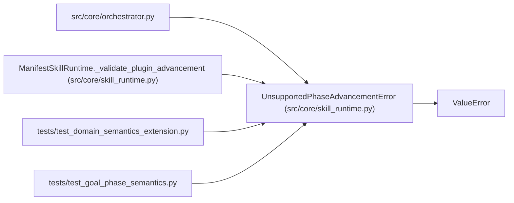

# UnsupportedPhaseAdvancementError

**Location:** `src/core/skill_runtime.py:156`
**Kind:** Class
**Bases:** `ValueError`
**Module:** [skill_runtime](../modules/skill_runtime.md)

## Description

Raised when a plugin phase-advancement declaration is unsupported.

A ``mode=plugin`` declaration requires a declared ``phase_advancement``
plugin entry (the qualified resolver implementation executes it under
the governed capability rules). Declarations without one, and other
unsupported forms, are rejected explicitly — declarative behavior is
never silently substituted.

## Attributes

*No annotated attributes found.*

## Methods

*No public methods. Inherits from base classes.*

## Relationships

<!-- Auto-generated relationship summary. Do not edit by hand. -->

### Summary

| Module | Methods | Attributes |
|---|---:|---|
| [skill_runtime](../modules/skill_runtime.md) | 0 | — |

### Structure

| Kind | Entity | Module |
|---|---|---|
| Base | `ValueError` | — |

### References

| Reference | Kind | Source | Call sites |
|---|---|---|---:|
| `orchestrator` | import | [orchestrator](../modules/orchestrator.md) | — |
| `ManifestSkillRuntime._validate_plugin_advancement` | call | [skill_runtime](../modules/skill_runtime.md) | 1 |
| `test_domain_semantics_extension` | import | [test_domain_semantics_extension](../modules/test_domain_semantics_extension.md) | — |
| `test_goal_phase_semantics` | import | [test_goal_phase_semantics](../modules/test_goal_phase_semantics.md) | — |
