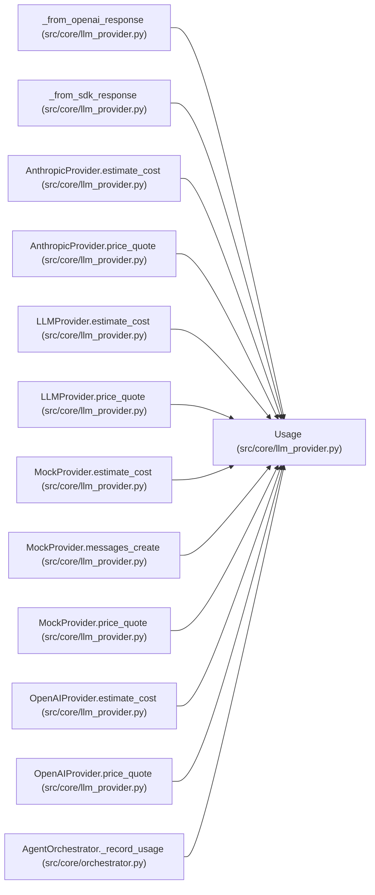

# Usage

**Location:** `src/core/llm_provider.py:145`
**Kind:** Class
**Bases:** —
**Module:** [llm_provider](../modules/llm_provider.md)

**Decorators:** `@dataclass(frozen=True)`

## Description

Token accounting for one provider call (spike §3.6).

``cache_read_tokens`` / ``cache_write_tokens`` default to 0 and are unused
today (the orchestrator reads only input/output, ``orchestrator.py``
``run``); additive so P1-003 can capture cache-aware cost without breaking
parity.

## Attributes

| Name | Type | Default | Description |
|------|------|---------|-------------|
| `input_tokens` | `int` | *required* | — |
| `output_tokens` | `int` | *required* | — |
| `cache_read_tokens` | `int` | `0` | — |
| `cache_write_tokens` | `int` | `0` | — |
| `reasoning_tokens` | `int` | `0` | — |

## Methods

*No public methods. Inherits from base classes.*

## Relationships

<!-- Auto-generated relationship summary. Do not edit by hand. -->

### Summary

| Module | Methods | Attributes |
|---|---:|---|
| [llm_provider](../modules/llm_provider.md) | 0 | `cache_read_tokens`, `cache_write_tokens`, `input_tokens`, `output_tokens`, `reasoning_tokens` |

### References

| Reference | Kind | Source | Call sites |
|---|---|---|---:|
| `_from_openai_response` | call | [llm_provider](../modules/llm_provider.md) | 1 |
| `_from_sdk_response` | call | [llm_provider](../modules/llm_provider.md) | 1 |
| `AnthropicProvider.estimate_cost` | type_reference | [llm_provider](../modules/llm_provider.md) | — |
| `AnthropicProvider.price_quote` | type_reference | [llm_provider](../modules/llm_provider.md) | — |
| `LLMProvider.estimate_cost` | type_reference | [llm_provider](../modules/llm_provider.md) | — |
| `LLMProvider.price_quote` | type_reference | [llm_provider](../modules/llm_provider.md) | — |
| `MockProvider.estimate_cost` | type_reference | [llm_provider](../modules/llm_provider.md) | — |
| `MockProvider.messages_create` | call | [llm_provider](../modules/llm_provider.md) | 3 |
| `MockProvider.price_quote` | type_reference | [llm_provider](../modules/llm_provider.md) | — |
| `OpenAIProvider.estimate_cost` | type_reference | [llm_provider](../modules/llm_provider.md) | — |
| `OpenAIProvider.price_quote` | type_reference | [llm_provider](../modules/llm_provider.md) | — |
| `AgentOrchestrator._record_usage` | type_reference | [orchestrator](../modules/orchestrator.md) | — |

> References: showing 12 of 35 logical references; 23 omitted by the 12-row generated summary limit.
