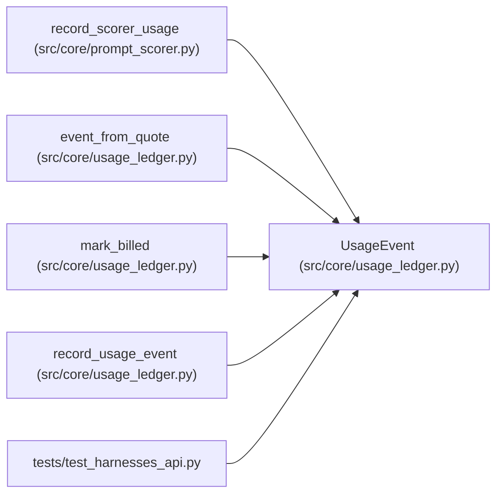

# UsageEvent

**Location:** `src/core/usage_ledger.py:32`
**Kind:** Class
**Bases:** —
**Module:** [usage_ledger](../modules/usage_ledger.md)

**Decorators:** `@dataclass(frozen=True)`

## Description

One metered provider call with its cost knowledge.

## Attributes

| Name | Type | Default | Description |
|------|------|---------|-------------|
| `event_key` | `str` | *required* | — |
| `research_id` | `str` | *required* | — |
| `role` | `str` | *required* | — |
| `provider` | `str` | *required* | — |
| `model` | `str` | *required* | — |
| `usage` | `Usage` | *required* | — |
| `cost_status` | `str` | *required* | — |
| `cost_usd` | `Optional[float]` | *required* | — |
| `pricing_basis` | `Dict[str, Any]` | `field(default_factory=dict)` | — |
| `iteration` | `Optional[int]` | `None` | — |
| `turn` | `Optional[int]` | `None` | — |

## Methods

| Method | Signature | Decorators | Description |
|--------|-----------|------------|-------------|
| `as_row` | `() -> Dict[str, Any]` | — | — |

## Relationships

<!-- Auto-generated relationship summary. Do not edit by hand. -->

### Summary

| Module | Methods | Attributes |
|---|---:|---|
| [usage_ledger](../modules/usage_ledger.md) | 1 | `cost_status`, `cost_usd`, `event_key`, `iteration`, `model`, `pricing_basis`, `provider`, `research_id`, `role`, `turn`, `usage` |

### References

| Reference | Kind | Source | Call sites |
|---|---|---|---:|
| `record_scorer_usage` | call | [prompt_scorer](../modules/prompt_scorer.md) | 1 |
| `event_from_quote` | call | [usage_ledger](../modules/usage_ledger.md) | 1 |
| `event_from_quote` | type_reference | [usage_ledger](../modules/usage_ledger.md) | — |
| `mark_billed` | call | [usage_ledger](../modules/usage_ledger.md) | 1 |
| `mark_billed` | type_reference | [usage_ledger](../modules/usage_ledger.md) | — |
| `record_usage_event` | type_reference | [usage_ledger](../modules/usage_ledger.md) | — |
| `test_harnesses_api` | import | [test_harnesses_api](../modules/test_harnesses_api.md) | — |
