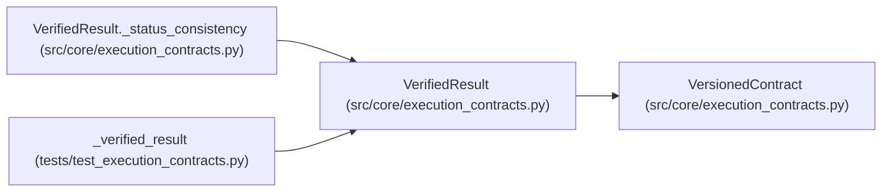

# VerifiedResult

**Location:** `src/core/execution_contracts.py:604`
**Kind:** Pydantic model
**Bases:** `VersionedContract`
**Module:** [execution_contracts](../modules/execution_contracts.md)

## Description

An evaluator-owned measurement of one candidate in one context.

Authoritative metrics arrive through this envelope from the trusted
evaluator channel. Model output may propose candidates and annotate
results, but it never fills this contract. Third-party results carry
``provenance="imported"`` and stay ``unverified_imported`` until
independently validated.

## Model Configuration

| Setting | Value | Source |
|---------|-------|--------|
| `extra` | `'forbid'` | model_config |
| `allow_inf_nan` | `False` | model_config |

## Validators

| Method | Scope | Fields | Mode | Options |
|--------|-------|--------|------|---------|
| `_digest_shape` | field | evaluator_digest | after | — |
| `_status_consistency` | model | — | after | — |

## Attributes

| Name | Type | Wire name | Required | Nullable | Default | Constraints | Examples | Description |
|------|------|-----------|----------|----------|---------|-------------|-------------|----------|
| `schema_version` | `str` | `schema_version` | No | No | `VERIFIED_RESULT_SCHEMA_VERSION` | — | — | — |
| `result_id` | `str` | `result_id` | Yes | No | — | min_length=1 | — | — |
| `run_id` | `str` | `run_id` | Yes | No | — | min_length=1 | — | — |
| `attempt_id` | `str` | `attempt_id` | Yes | No | — | min_length=1 | — | — |
| `candidate` | `CandidateIdentity` | `candidate` | Yes | No | — | — | — | — |
| `observation` | `ObservationIdentity` | `observation` | Yes | No | — | — | — | — |
| `status` | `Literal['succeeded', 'failed', 'timeout', 'rejected']` | `status` | Yes | No | — | — | — | — |
| `metrics` | `dict[str, float]` | `metrics` | No | No | factory: `dict` | — | — | — |
| `failure` | `Optional[FailureRecord]` | `failure` | No | Yes | `None` | — | — | — |
| `evaluator_digest` | `str` | `evaluator_digest` | Yes | No | — | — | — | — |
| `receipt` | `ResultReceipt` | `receipt` | Yes | No | — | — | — | — |
| `produced_at` | `str` | `produced_at` | Yes | No | — | min_length=1 | — | — |
| `provenance` | `Literal['evaluator_owned', 'imported']` | `provenance` | Yes | No | — | — | — | — |
| `verification` | `Literal['verified', 'unverified_imported']` | `verification` | Yes | No | — | — | — | — |

## Methods

| Method | Signature | Decorators | Description |
|--------|-----------|------------|-------------|
| `_digest_shape` | `(value: str) -> str` | `@field_validator('evaluator_digest')`, `@classmethod` | — |
| `_status_consistency` | `() -> 'VerifiedResult'` | `@model_validator(mode='after')` | — |

## Relationships

<!-- Auto-generated relationship summary. Do not edit by hand. -->

### Summary

| Module | Methods | Attributes |
|---|---:|---|
| [execution_contracts](../modules/execution_contracts.md) | 2 | `attempt_id`, `candidate`, `evaluator_digest`, `failure`, `metrics`, `observation`, `produced_at`, `provenance`, `receipt`, `result_id`, `run_id`, `schema_version` |

### Structure

| Kind | Entity | Module |
|---|---|---|
| Base | `VersionedContract` | [execution_contracts](../modules/execution_contracts.md) |

### References

| Reference | Kind | Source | Call sites |
|---|---|---|---:|
| `VerifiedResult._status_consistency` | type_reference | [execution_contracts](../modules/execution_contracts.md) | — |
| `_verified_result` | call | [test_execution_contracts](../modules/test_execution_contracts.md) | 1 |
