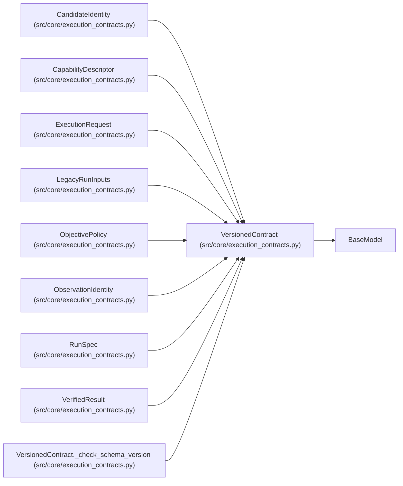

# VersionedContract

**Location:** `src/core/execution_contracts.py:75`
**Kind:** Pydantic model
**Bases:** `BaseModel`
**Module:** [execution_contracts](../modules/execution_contracts.md)

## Description

Base for top-level contracts: pins ``schema_version`` to its family.

Subclasses declare their expected version as a class attribute and give
``schema_version`` the matching default. Any other version — a newer
writer or a corrupted artifact — fails explicitly at parse time.

## Model Configuration

| Setting | Value | Source |
|---------|-------|--------|
| `extra` | `'forbid'` | model_config |

## Validators

| Method | Scope | Fields | Mode | Options |
|--------|-------|--------|------|---------|
| `_check_schema_version` | model | — | after | — |

## Attributes

| Name | Type | Wire name | Required | Nullable | Default | Constraints | Examples | Description |
|------|------|-----------|----------|----------|---------|-------------|-------------|----------|
| `EXPECTED_SCHEMA_VERSION` | `ClassVar[str]` | `EXPECTED_SCHEMA_VERSION` | No | No | `''` | — | — | — |
| `schema_version` | `str` | `schema_version` | Yes | No | — | — | — | — |

## Methods

| Method | Signature | Decorators | Description |
|--------|-----------|------------|-------------|
| `_check_schema_version` | `() -> 'VersionedContract'` | `@model_validator(mode='after')` | — |

## Relationships

<!-- Auto-generated relationship summary. Do not edit by hand. -->

### Summary

| Module | Methods | Attributes |
|---|---:|---|
| [execution_contracts](../modules/execution_contracts.md) | 1 | `EXPECTED_SCHEMA_VERSION`, `schema_version` |

### Structure

| Kind | Entity | Module |
|---|---|---|
| Base | `BaseModel` | — |
| Subclass | `CandidateIdentity` | [execution_contracts](../modules/execution_contracts.md) |
| Subclass | `CapabilityDescriptor` | [execution_contracts](../modules/execution_contracts.md) |
| Subclass | `ExecutionRequest` | [execution_contracts](../modules/execution_contracts.md) |
| Subclass | `LegacyRunInputs` | [execution_contracts](../modules/execution_contracts.md) |
| Subclass | `ObjectivePolicy` | [execution_contracts](../modules/execution_contracts.md) |
| Subclass | `ObservationIdentity` | [execution_contracts](../modules/execution_contracts.md) |
| Subclass | `RunSpec` | [execution_contracts](../modules/execution_contracts.md) |
| Subclass | `VerifiedResult` | [execution_contracts](../modules/execution_contracts.md) |

### References

| Reference | Kind | Source | Call sites |
|---|---|---|---:|
| `VersionedContract._check_schema_version` | type_reference | [execution_contracts](../modules/execution_contracts.md) | — |
