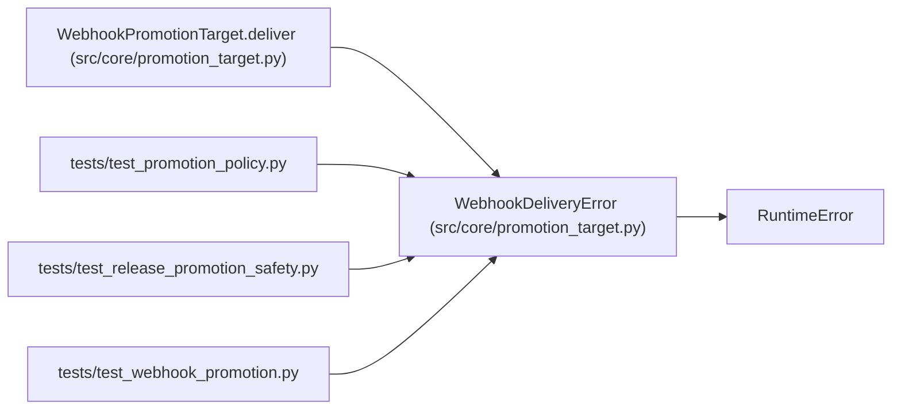

# WebhookDeliveryError

**Location:** `src/core/promotion_target.py:447`
**Kind:** Class
**Bases:** `RuntimeError`
**Module:** [promotion_target](../modules/promotion_target.md)

## Description

A webhook promotion delivery failed after all retries (fail-closed).

## Attributes

*No annotated attributes found.*

## Methods

*No public methods. Inherits from base classes.*

## Relationships

<!-- Auto-generated relationship summary. Do not edit by hand. -->

### Summary

| Module | Methods | Attributes |
|---|---:|---|
| [promotion_target](../modules/promotion_target.md) | 0 | — |

### Structure

| Kind | Entity | Module |
|---|---|---|
| Base | `RuntimeError` | — |

### References

| Reference | Kind | Source | Call sites |
|---|---|---|---:|
| `WebhookPromotionTarget.deliver` | call | [promotion_target](../modules/promotion_target.md) | 1 |
| `test_promotion_policy` | import | [test_promotion_policy](../modules/test_promotion_policy.md) | — |
| `test_release_promotion_safety` | import | [test_release_promotion_safety](../modules/test_release_promotion_safety.md) | — |
| `test_webhook_promotion` | import | [test_webhook_promotion](../modules/test_webhook_promotion.md) | — |
