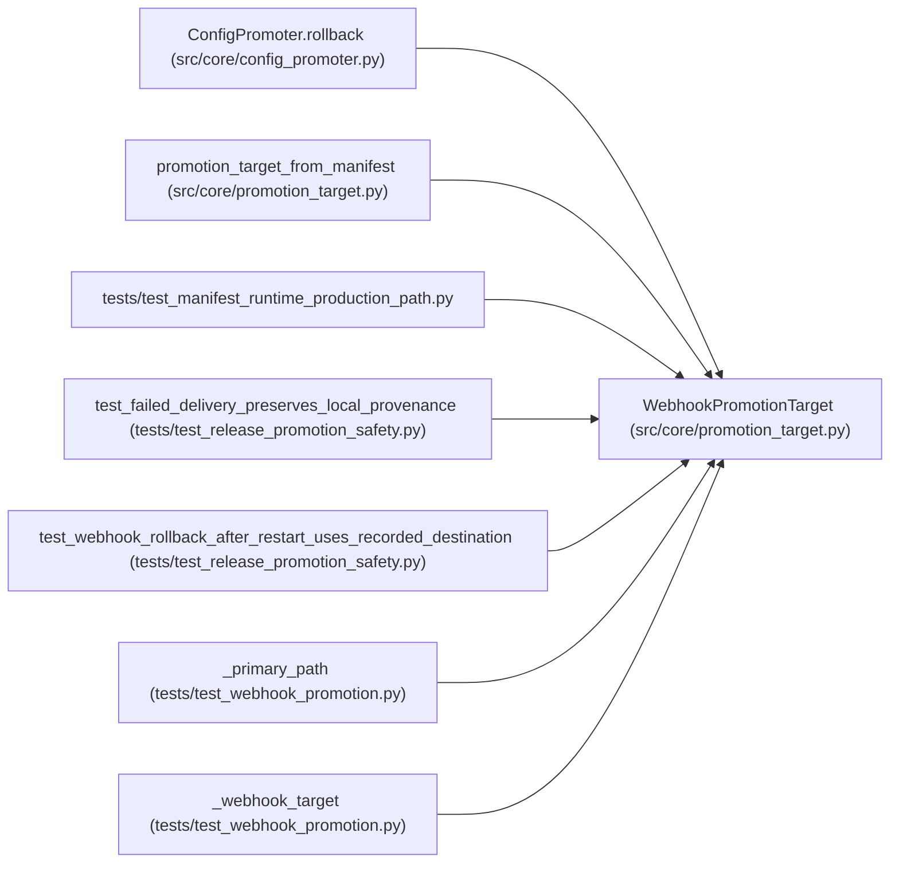

# WebhookPromotionTarget

**Location:** `src/core/promotion_target.py:264`
**Kind:** Class
**Bases:** —
**Module:** [promotion_target](../modules/promotion_target.md)

## Description

Promote by POSTing the winning config to an HTTP endpoint (P1-3).

Implements the file-shaped ``PromotionTarget`` protocol so the whole
``ConfigPromoter`` gate/metadata/rollback machinery keeps working: every
write lands atomically in a local provenance tree
(``<workspace_root>/promotions/...``), and the *primary* config write is
additionally delivered to the declared webhook endpoint with an
``Idempotency-Key`` and optional Bearer auth. Delivery failures raise
``WebhookDeliveryError`` so ``confirm`` surfaces them (fail-closed).

Serves both ``promotion_target.kind: webhook`` manifests and
``kind: registry_api`` manifests (a registry register-endpoint is a
webhook delivery with an auth secret).

## Attributes

*No annotated attributes found.*

## Methods

| Method | Signature | Decorators | Description |
|--------|-----------|------------|-------------|
| `__init__` | `(*, endpoint: str, auth_env_var: str \| None = None, timeout_s: float = 10.0, retries: int = 2, local_root: str \| None = None) -> None` | — | — |
| `target_path` | `(*, model_type: str, instrument: str, timeframe: str, skill_id: str = '') -> str` | — | — |
| `metadata_sidecar_path` | `(target_path: str, iteration: int, *, scope: str = 'development') -> str` | — | — |
| `rollback_snapshot_path` | `(*, target_path: str, research_id: str, iteration: int) -> str` | — | — |
| `rollback_metadata_sidecar_path` | `(target_path: str, promotion_id: int) -> str` | — | — |
| `write` | *(async)* `(path: str, content: str) -> None` | — | Deliver primary configs before advancing the local provenance copy. |
| `restore` | *(async)* `(path: str, content: str, *, promotion_id: int) -> None` | — | Explicit remote restore, independent of this instance's path cache. |
| `deliver` | *(async)* `(path: str, content: str, *, operation: str = 'promote') -> dict[str, Any]` | — | POST the promoted config to the endpoint (retries, idempotent key). |

## Relationships

<!-- Auto-generated relationship summary. Do not edit by hand. -->

### Summary

| Module | Methods | Attributes |
|---|---:|---|
| [promotion_target](../modules/promotion_target.md) | 8 | — |

### References

| Reference | Kind | Source | Call sites |
|---|---|---|---:|
| `ConfigPromoter.rollback` | call | [config_promoter](../modules/config_promoter.md) | 1 |
| `promotion_target_from_manifest` | call | [promotion_target](../modules/promotion_target.md) | 2 |
| `test_manifest_runtime_production_path` | import | [test_manifest_runtime_production_path](../modules/test_manifest_runtime_production_path.md) | — |
| `test_failed_delivery_preserves_local_provenance` | call | [test_release_promotion_safety](../modules/test_release_promotion_safety.md) | 1 |
| `test_webhook_rollback_after_restart_uses_recorded_destination` | call | [test_release_promotion_safety](../modules/test_release_promotion_safety.md) | 1 |
| `_primary_path` | type_reference | [test_webhook_promotion](../modules/test_webhook_promotion.md) | — |
| `_webhook_target` | call | [test_webhook_promotion](../modules/test_webhook_promotion.md) | 1 |
| `_webhook_target` | type_reference | [test_webhook_promotion](../modules/test_webhook_promotion.md) | — |
