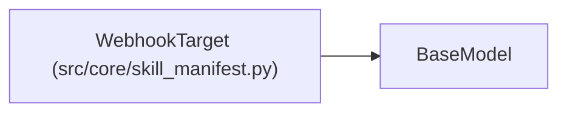

# WebhookTarget

**Location:** `src/core/skill_manifest.py:848`
**Kind:** Pydantic model
**Bases:** `BaseModel`
**Module:** [skill_manifest](../modules/skill_manifest.md)

## Description

``kind: webhook`` — POST the winning config to an HTTP endpoint (P1-3).

The delivery is idempotent (``Idempotency-Key`` derived from the promoted
content) and fail-closed (delivery failure fails the confirm). A local
provenance copy is always written under ``<workspace>/promotions/``.

## Model Configuration

| Setting | Value | Source |
|---------|-------|--------|
| `extra` | `'forbid'` | model_config |

## Attributes

| Name | Type | Wire name | Required | Nullable | Default | Constraints | Examples | Description |
|------|------|-----------|----------|----------|---------|-------------|-------------|----------|
| `kind` | `Literal['webhook']` | `kind` | No | No | `'webhook'` | — | — | — |
| `endpoint` | `str` | `endpoint` | Yes | No | — | — | — | — |
| `auth_secret` | `Optional[str]` | `auth_secret` | No | Yes | `None` | — | — | — |
| `timeout_s` | `float` | `timeout_s` | No | No | `10.0` | gt=0 | — | — |
| `retries` | `int` | `retries` | No | No | `2` | ge=0 | — | — |

## Methods

*No public methods. Inherits from base classes.*

## Relationships

<!-- Auto-generated relationship summary. Do not edit by hand. -->

### Summary

| Module | Methods | Attributes |
|---|---:|---|
| [skill_manifest](../modules/skill_manifest.md) | 0 | `auth_secret`, `endpoint`, `kind`, `retries`, `timeout_s` |

### Structure

| Kind | Entity | Module |
|---|---|---|
| Base | `BaseModel` | — |
