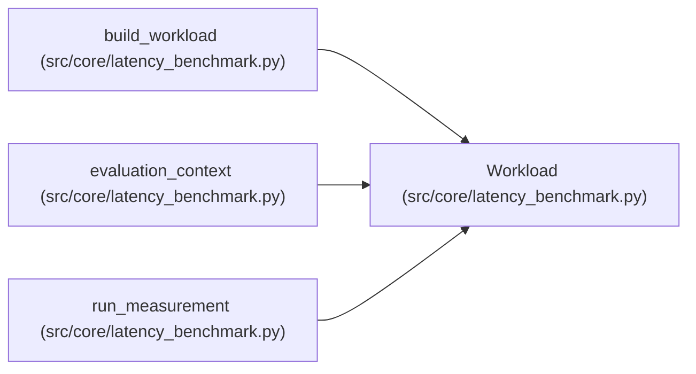

# Workload

**Location:** `src/core/latency_benchmark.py:34`
**Kind:** Class
**Bases:** —
**Module:** [latency_benchmark](../modules/latency_benchmark.md)

**Decorators:** `@dataclass(frozen=True)`

## Description

The fixed data/query workload: a dataset and a frozen request mix.

## Attributes

| Name | Type | Default | Description |
|------|------|---------|-------------|
| `workload_id` | `str` | *required* | — |
| `items` | `tuple[tuple[str, float], ...]` | *required* | — |
| `request_keys` | `tuple[str, ...]` | *required* | — |

## Methods

| Method | Signature | Decorators | Description |
|--------|-----------|------------|-------------|
| `digest` | `() -> str` | — | — |

## Relationships

<!-- Auto-generated relationship summary. Do not edit by hand. -->

### Summary

| Module | Methods | Attributes |
|---|---:|---|
| [latency_benchmark](../modules/latency_benchmark.md) | 1 | `items`, `request_keys`, `workload_id` |

### References

| Reference | Kind | Source | Call sites |
|---|---|---|---:|
| `build_workload` | call | [latency_benchmark](../modules/latency_benchmark.md) | 1 |
| `build_workload` | type_reference | [latency_benchmark](../modules/latency_benchmark.md) | — |
| `evaluation_context` | type_reference | [latency_benchmark](../modules/latency_benchmark.md) | — |
| `run_measurement` | type_reference | [latency_benchmark](../modules/latency_benchmark.md) | — |
