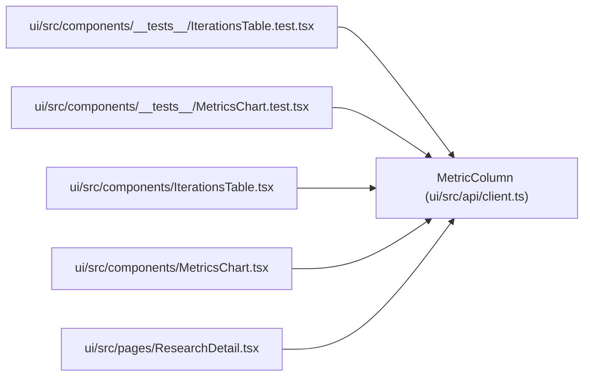

# MetricColumn

**Location:** `ui/src/api/client.ts:513`
**Kind:** Class
**Bases:** —
**Module:** [client](../modules/client.md)

## Description

_Auto-generated from `MetricColumn` in `ui/src/api/client.ts`._

## Attributes

| Name | Type | Required | Default | Description |
|------|------|----------|---------|-------------|
| `field` | `string` | Yes | — | — |
| `label` | `string` | Yes | — | — |
| `kind` | `string` | No | — | — |
| `axis` | `'left' \| 'right'` | No | — | — |
| `format` | `string` | No | — | — |

## Methods

*No public methods. Inherits from base classes.*

## Relationships

<!-- Auto-generated relationship summary. Do not edit by hand. -->

### Summary

| Module | Methods | Attributes |
|---|---:|---|
| [client](../modules/client.md) | 0 | `axis`, `field`, `format`, `kind`, `label` |

### References

| Reference | Kind | Source | Call sites |
|---|---|---|---:|
| `IterationsTable.test` | import | [IterationsTable.test](../modules/IterationsTable.test.md) | — |
| `MetricsChart.test` | import | [MetricsChart.test](../modules/MetricsChart.test.md) | — |
| `IterationsTable` | import | [IterationsTable](../modules/IterationsTable.md) | — |
| `MetricsChart` | import | [MetricsChart](../modules/MetricsChart.md) | — |
| `ResearchDetail` | import | [ResearchDetail](../modules/ResearchDetail.md) | — |
