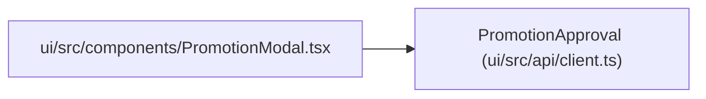

# PromotionApproval

**Location:** `ui/src/api/client.ts:127`
**Kind:** Class
**Bases:** —
**Module:** [client](../modules/client.md)

## Description

_Auto-generated from `PromotionApproval` in `ui/src/api/client.ts`._

## Attributes

| Name | Type | Required | Default | Description |
|------|------|----------|---------|-------------|
| `approver` | `string` | No | — | — |
| `reason` | `string` | No | — | — |
| `method` | `string` | No | — | — |
| `signature` | `string` | No | — | — |
| `approved` | `boolean` | No | — | — |
| `iteration` | `number` | No | — | — |
| `config_snapshot_sha256` | `string` | No | — | — |
| `target_identity` | `string` | No | — | — |

## Methods

*No public methods. Inherits from base classes.*

## Relationships

<!-- Auto-generated relationship summary. Do not edit by hand. -->

### Summary

| Module | Methods | Attributes |
|---|---:|---|
| [client](../modules/client.md) | 0 | `approved`, `approver`, `config_snapshot_sha256`, `iteration`, `method`, `reason`, `signature`, `target_identity` |

### References

| Reference | Kind | Source | Call sites |
|---|---|---|---:|
| `PromotionModal` | import | [PromotionModal](../modules/PromotionModal.md) | — |
