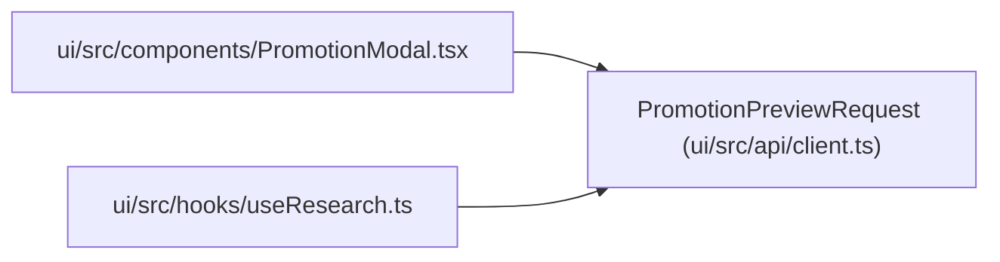

# PromotionPreviewRequest

**Location:** `ui/src/api/client.ts:139`
**Kind:** Class
**Bases:** —
**Module:** [client](../modules/client.md)

## Description

_Auto-generated from `PromotionPreviewRequest` in `ui/src/api/client.ts`._

## Attributes

| Name | Type | Required | Default | Description |
|------|------|----------|---------|-------------|
| `scope` | `PromotionScope` | Yes | — | — |
| `approval` | `PromotionApproval \| null` | No | — | — |

## Methods

*No public methods. Inherits from base classes.*

## Relationships

<!-- Auto-generated relationship summary. Do not edit by hand. -->

### Summary

| Module | Methods | Attributes |
|---|---:|---|
| [client](../modules/client.md) | 0 | `approval`, `scope` |

### References

| Reference | Kind | Source | Call sites |
|---|---|---|---:|
| `PromotionModal` | import | [PromotionModal](../modules/PromotionModal.md) | — |
| `useResearch` | import | [useResearch](../modules/useResearch.md) | — |
