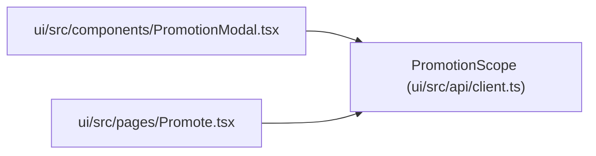

# PromotionScope

**Location:** `ui/src/api/client.ts:125`
**Kind:** Type alias
**Bases:** —
**Module:** [client](../modules/client.md)

## Description

_Auto-generated from `PromotionScope` in `ui/src/api/client.ts`._

## Attributes

*No annotated attributes found.*

## Methods

*No public methods. Inherits from base classes.*

## Relationships

<!-- Auto-generated relationship summary. Do not edit by hand. -->

### Summary

| Module | Methods | Attributes |
|---|---:|---|
| [client](../modules/client.md) | 0 | — |

### References

| Reference | Kind | Source | Call sites |
|---|---|---|---:|
| `PromotionModal` | import | [PromotionModal](../modules/PromotionModal.md) | — |
| `Promote` | import | [Promote](../modules/Promote.md) | — |
