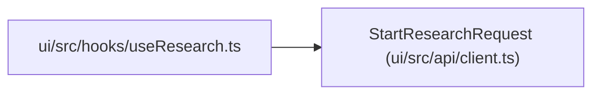

# StartResearchRequest

**Location:** `ui/src/api/client.ts:212`
**Kind:** Class
**Bases:** —
**Module:** [client](../modules/client.md)

## Description

_Auto-generated from `StartResearchRequest` in `ui/src/api/client.ts`._

## Attributes

| Name | Type | Required | Default | Description |
|------|------|----------|---------|-------------|
| `skill_id` | `string` | No | — | — |
| `subject_id` | `string` | No | — | — |
| `variant` | `string` | No | — | — |
| `skill_params` | `Record<string, unknown>` | No | — | — |
| `tag` | `string` | No | — | — |
| `quick_mode` | `boolean` | No | — | — |
| `max_iterations` | `number` | No | — | — |
| `max_budget_usd` | `number` | No | — | — |
| `timeout_minutes` | `number` | No | — | — |
| `focus_hint` | `string` | No | — | — |

## Methods

*No public methods. Inherits from base classes.*

## Relationships

<!-- Auto-generated relationship summary. Do not edit by hand. -->

### Summary

| Module | Methods | Attributes |
|---|---:|---|
| [client](../modules/client.md) | 0 | `focus_hint`, `max_budget_usd`, `max_iterations`, `quick_mode`, `skill_id`, `skill_params`, `subject_id`, `tag`, `timeout_minutes`, `variant` |

### References

| Reference | Kind | Source | Call sites |
|---|---|---|---:|
| `useResearch` | import | [useResearch](../modules/useResearch.md) | — |
