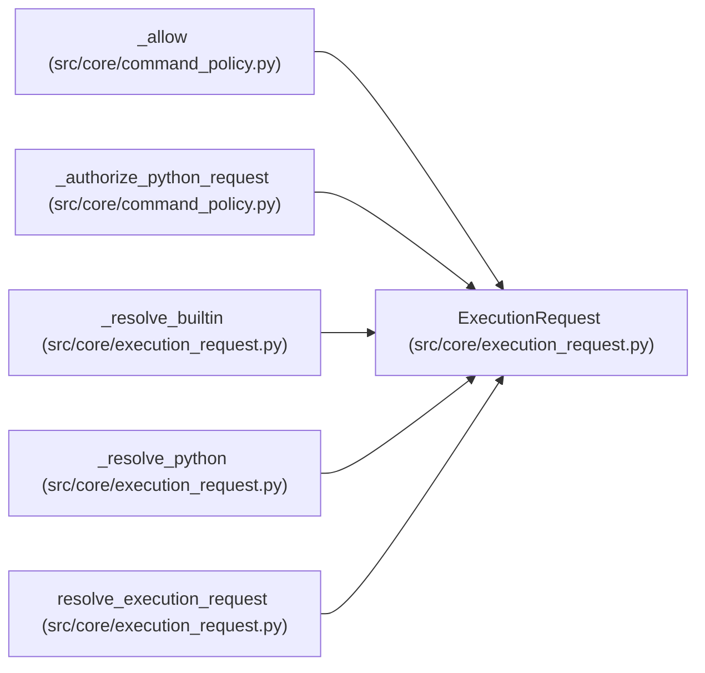

# ExecutionRequest

**Location:** `src/core/execution_request.py:87`
**Kind:** Class
**Bases:** —
**Module:** [execution_request](../modules/execution_request.md)

**Decorators:** `@dataclass(frozen=True)`

## Description

The immutable, typed result of resolving one execution request.

## Attributes

| Name | Type | Default | Description |
|------|------|---------|-------------|
| `schema_version` | `str` | *required* | — |
| `operation` | `str` | *required* | — |
| `executable` | `str` | *required* | — |
| `exec_prefix` | `tuple[str, ...]` | *required* | — |
| `script` | `Optional[str]` | *required* | — |
| `arguments` | `tuple[str, ...]` | *required* | — |
| `argv` | `tuple[str, ...]` | *required* | — |
| `cwd` | `str` | *required* | — |
| `inputs` | `tuple[str, ...]` | *required* | — |
| `outputs` | `tuple[str, ...]` | *required* | — |
| `config_path` | `Optional[str]` | *required* | — |
| `timeout_s` | `int` | *required* | — |
| `fixed_arguments` | `tuple[str, ...]` | *required* | — |
| `execution_identity` | `Optional[Mapping[str, Any]]` | `None` | — |

## Methods

| Method | Signature | Decorators | Description |
|--------|-----------|------------|-------------|
| `to_meta` | `() -> dict[str, Any]` | — | JSON-safe provenance summary for tool metadata / markers. |

## Relationships

<!-- Auto-generated relationship summary. Do not edit by hand. -->

### Summary

| Module | Methods | Attributes |
|---|---:|---|
| [execution_request](../modules/execution_request.md) | 1 | `arguments`, `argv`, `config_path`, `cwd`, `exec_prefix`, `executable`, `execution_identity`, `fixed_arguments`, `inputs`, `operation`, `outputs`, `schema_version` |

### References

| Reference | Kind | Source | Call sites |
|---|---|---|---:|
| `_allow` | type_reference | [command_policy](../modules/command_policy.md) | — |
| `_authorize_python_request` | type_reference | [command_policy](../modules/command_policy.md) | — |
| `_resolve_builtin` | call | [execution_request](../modules/execution_request.md) | 1 |
| `_resolve_builtin` | type_reference | [execution_request](../modules/execution_request.md) | — |
| `_resolve_python` | call | [execution_request](../modules/execution_request.md) | 1 |
| `_resolve_python` | type_reference | [execution_request](../modules/execution_request.md) | — |
| `resolve_execution_request` | type_reference | [execution_request](../modules/execution_request.md) | — |
