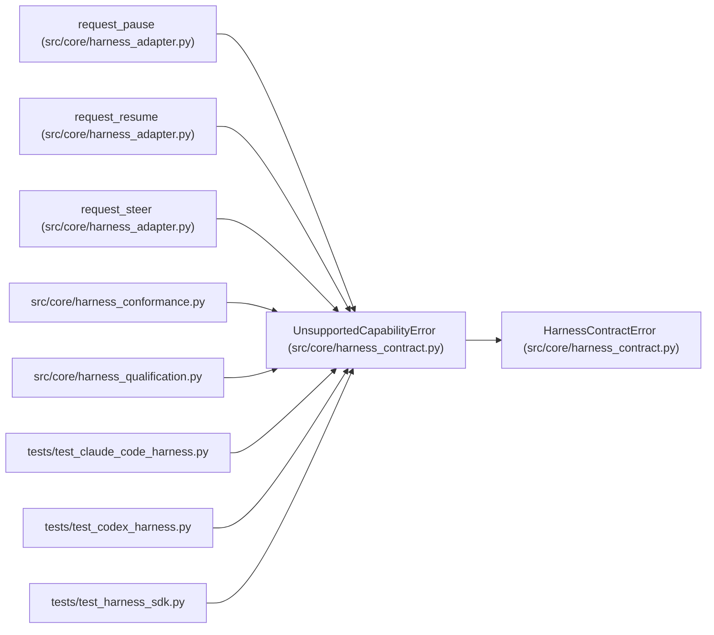

# UnsupportedCapabilityError

**Location:** `src/core/harness_contract.py:82`
**Kind:** Class
**Bases:** `HarnessContractError`
**Module:** [harness_contract](../modules/harness_contract.md)

## Description

An optional capability was requested but is not advertised.

Refusal is explicit: the SDK never substitutes a different operation
(a kill is not a pause) and never silently no-ops.

## Attributes

*No annotated attributes found.*

## Methods

| Method | Signature | Decorators | Description |
|--------|-----------|------------|-------------|
| `__init__` | `(capability: str, adapter_name: str) -> None` | — | — |

## Relationships

<!-- Auto-generated relationship summary. Do not edit by hand. -->

### Summary

| Module | Methods | Attributes |
|---|---:|---|
| [harness_contract](../modules/harness_contract.md) | 1 | — |

### Structure

| Kind | Entity | Module |
|---|---|---|
| Base | `HarnessContractError` | [harness_contract](../modules/harness_contract.md) |

### References

| Reference | Kind | Source | Call sites |
|---|---|---|---:|
| `request_pause` | call | [harness_adapter](../modules/harness_adapter.md) | 1 |
| `request_resume` | call | [harness_adapter](../modules/harness_adapter.md) | 1 |
| `request_steer` | call | [harness_adapter](../modules/harness_adapter.md) | 1 |
| `harness_conformance` | import | [harness_conformance](../modules/harness_conformance.md) | — |
| `harness_qualification` | import | [harness_qualification](../modules/harness_qualification.md) | — |
| `test_claude_code_harness` | import | [test_claude_code_harness](../modules/test_claude_code_harness.md) | — |
| `test_codex_harness` | import | [test_codex_harness](../modules/test_codex_harness.md) | — |
| `test_harness_sdk` | import | [test_harness_sdk](../modules/test_harness_sdk.md) | — |
