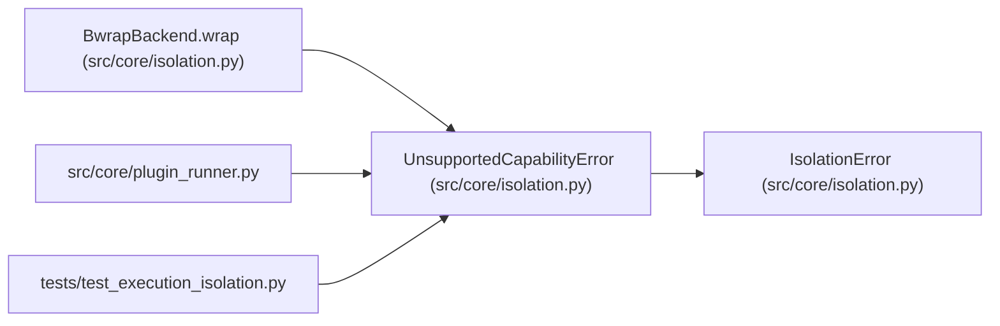

# UnsupportedCapabilityError

**Location:** `src/core/isolation.py:61`
**Kind:** Class
**Bases:** `IsolationError`
**Module:** [isolation](../modules/isolation.md)

## Description

A capability request the selected backend cannot enforce.

## Attributes

*No annotated attributes found.*

## Methods

*No public methods. Inherits from base classes.*

## Relationships

<!-- Auto-generated relationship summary. Do not edit by hand. -->

### Summary

| Module | Methods | Attributes |
|---|---:|---|
| [isolation](../modules/isolation.md) | 0 | — |

### Structure

| Kind | Entity | Module |
|---|---|---|
| Base | `IsolationError` | [isolation](../modules/isolation.md) |

### References

| Reference | Kind | Source | Call sites |
|---|---|---|---:|
| `BwrapBackend.wrap` | call | [isolation](../modules/isolation.md) | 1 |
| `plugin_runner` | import | [plugin_runner](../modules/plugin_runner.md) | — |
| `test_execution_isolation` | import | [test_execution_isolation](../modules/test_execution_isolation.md) | — |
