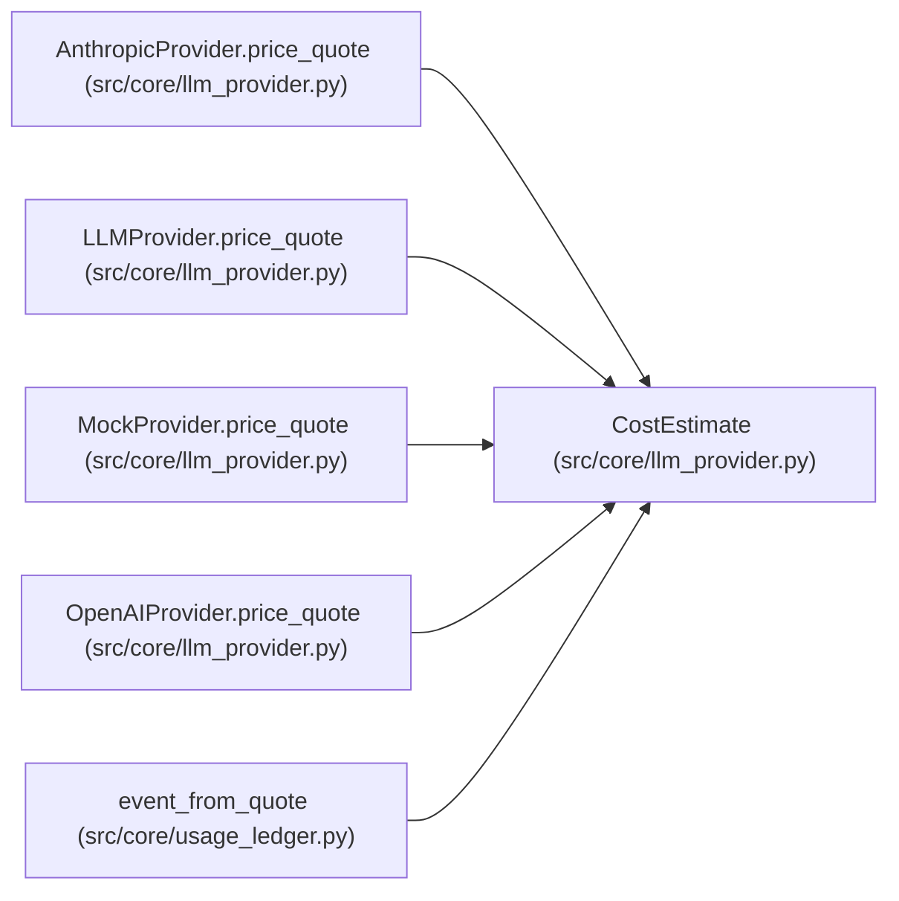

# CostEstimate

**Location:** `src/core/llm_provider.py:167`
**Kind:** Class
**Bases:** —
**Module:** [llm_provider](../modules/llm_provider.md)

**Decorators:** `@dataclass(frozen=True)`

## Description

Money knowledge for one call — never conflated with zero.

``money_usd`` is ``None`` exactly when the cost is unavailable (unknown
pricing); a zero is a real, priced zero. ``basis`` snapshots the pricing
the estimate used (versioned), so later price changes cannot silently
rewrite history.

## Attributes

| Name | Type | Default | Description |
|------|------|---------|-------------|
| `status` | `str` | *required* | — |
| `money_usd` | `Optional[float]` | *required* | — |
| `basis` | `dict[str, Any]` | *required* | — |

## Methods

*No public methods. Inherits from base classes.*

## Relationships

<!-- Auto-generated relationship summary. Do not edit by hand. -->

### Summary

| Module | Methods | Attributes |
|---|---:|---|
| [llm_provider](../modules/llm_provider.md) | 0 | `basis`, `money_usd`, `status` |

### References

| Reference | Kind | Source | Call sites |
|---|---|---|---:|
| `AnthropicProvider.price_quote` | call | [llm_provider](../modules/llm_provider.md) | 1 |
| `AnthropicProvider.price_quote` | type_reference | [llm_provider](../modules/llm_provider.md) | — |
| `LLMProvider.price_quote` | type_reference | [llm_provider](../modules/llm_provider.md) | — |
| `MockProvider.price_quote` | call | [llm_provider](../modules/llm_provider.md) | 1 |
| `MockProvider.price_quote` | type_reference | [llm_provider](../modules/llm_provider.md) | — |
| `OpenAIProvider.price_quote` | call | [llm_provider](../modules/llm_provider.md) | 3 |
| `OpenAIProvider.price_quote` | type_reference | [llm_provider](../modules/llm_provider.md) | — |
| `event_from_quote` | type_reference | [usage_ledger](../modules/usage_ledger.md) | — |
