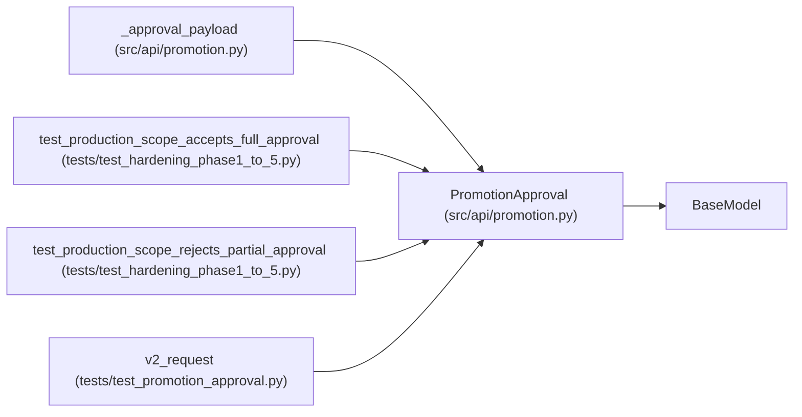

# PromotionApproval

**Location:** `src/api/promotion.py:114`
**Kind:** Pydantic model
**Bases:** `BaseModel`
**Module:** [promotion](../modules/promotion.md)

## Description

_Auto-generated from `PromotionApproval` in `src/api/promotion.py`._

## Attributes

| Name | Type | Wire name | Required | Nullable | Default | Constraints | Examples | Description |
|------|------|-----------|----------|----------|---------|-------------|-------------|----------|
| `approver` | `str \| None` | `approver` | No | Yes | `None` | — | — | — |
| `reason` | `str \| None` | `reason` | No | Yes | `None` | — | — | — |
| `method` | `str \| None` | `method` | No | Yes | `None` | — | — | — |
| `signature` | `str \| None` | `signature` | No | Yes | `None` | — | — | — |
| `approved` | `bool \| None` | `approved` | No | Yes | `None` | — | — | — |
| `iteration` | `int \| None` | `iteration` | No | Yes | `None` | ge=0; strict=True | — | — |
| `config_snapshot_sha256` | `str \| None` | `config_snapshot_sha256` | No | Yes | `None` | pattern='^[0-9a-f]{64}$' | — | — |
| `target_identity` | `str \| None` | `target_identity` | No | Yes | `None` | pattern='^[0-9a-f]{64}$' | — | — |

## Methods

*No public methods. Inherits from base classes.*

## Relationships

<!-- Auto-generated relationship summary. Do not edit by hand. -->

### Summary

| Module | Methods | Attributes |
|---|---:|---|
| [promotion](../modules/promotion.md) | 0 | `approved`, `approver`, `config_snapshot_sha256`, `iteration`, `method`, `reason`, `signature`, `target_identity` |

### Structure

| Kind | Entity | Module |
|---|---|---|
| Base | `BaseModel` | — |

### References

| Reference | Kind | Source | Call sites |
|---|---|---|---:|
| `_approval_payload` | type_reference | [promotion](../modules/promotion.md) | — |
| `test_production_scope_accepts_full_approval` | call | [test_hardening_phase1_to_5](../modules/test_hardening_phase1_to_5.md) | 1 |
| `test_production_scope_rejects_partial_approval` | call | [test_hardening_phase1_to_5](../modules/test_hardening_phase1_to_5.md) | 1 |
| `v2_request` | call | [test_promotion_approval](../modules/test_promotion_approval.md) | 1 |
