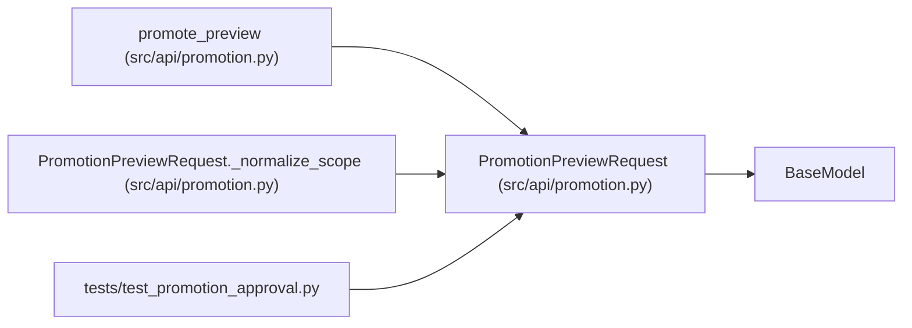

# PromotionPreviewRequest

**Location:** `src/api/promotion.py:132`
**Kind:** Pydantic model
**Bases:** `BaseModel`
**Module:** [promotion](../modules/promotion.md)

## Description

Unsigned discovery must be possible before an operator can sign a candidate.

## Model Configuration

| Setting | Value | Source |
|---------|-------|--------|
| `extra` | `'forbid'` | model_config |

## Validators

| Method | Scope | Fields | Mode | Options |
|--------|-------|--------|------|---------|
| `_normalize_scope` | model | — | after | — |

## Attributes

| Name | Type | Wire name | Required | Nullable | Default | Constraints | Examples | Description |
|------|------|-----------|----------|----------|---------|-------------|-------------|----------|
| `scope` | `str` | `scope` | No | No | `'development'` | — | — | — |
| `approval` | `PromotionApproval \| None` | `approval` | No | Yes | `None` | — | — | — |

## Methods

| Method | Signature | Decorators | Description |
|--------|-----------|------------|-------------|
| `_normalize_scope` | `() -> 'PromotionPreviewRequest'` | `@model_validator(mode='after')` | — |

## Relationships

<!-- Auto-generated relationship summary. Do not edit by hand. -->

### Summary

| Module | Methods | Attributes |
|---|---:|---|
| [promotion](../modules/promotion.md) | 1 | `approval`, `scope` |

### Structure

| Kind | Entity | Module |
|---|---|---|
| Base | `BaseModel` | — |

### References

| Reference | Kind | Source | Call sites |
|---|---|---|---:|
| `promote_preview` | call | [promotion](../modules/promotion.md) | 1 |
| `promote_preview` | type_reference | [promotion](../modules/promotion.md) | — |
| `PromotionPreviewRequest._normalize_scope` | type_reference | [promotion](../modules/promotion.md) | — |
| `test_promotion_approval` | import | [test_promotion_approval](../modules/test_promotion_approval.md) | — |
