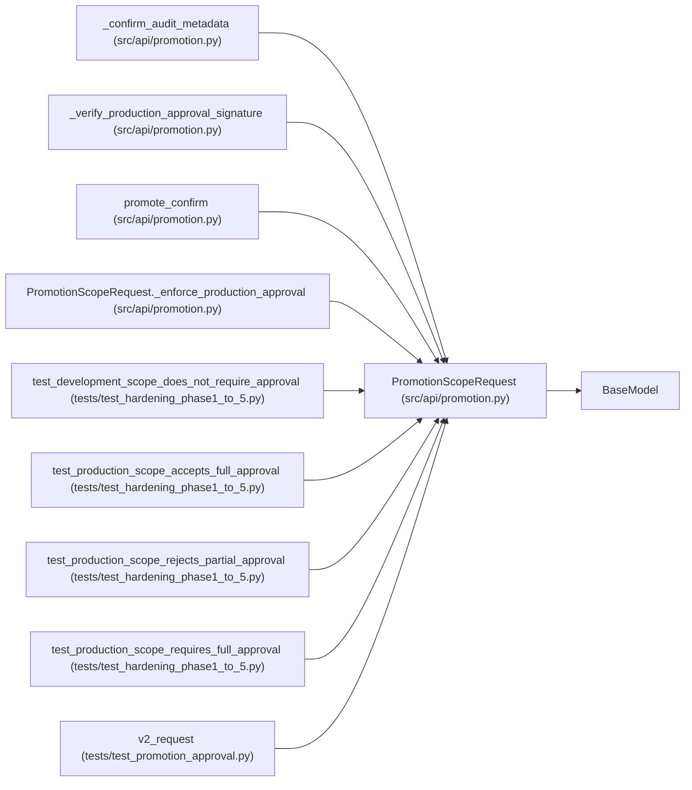

# PromotionScopeRequest

**Location:** `src/api/promotion.py:147`
**Kind:** Pydantic model
**Bases:** `BaseModel`
**Module:** [promotion](../modules/promotion.md)

## Description

_Auto-generated from `PromotionScopeRequest` in `src/api/promotion.py`._

## Model Configuration

| Setting | Value | Source |
|---------|-------|--------|
| `extra` | `'forbid'` | model_config |

## Validators

| Method | Scope | Fields | Mode | Options |
|--------|-------|--------|------|---------|
| `_enforce_production_approval` | model | — | after | — |

## Attributes

| Name | Type | Wire name | Required | Nullable | Default | Constraints | Examples | Description |
|------|------|-----------|----------|----------|---------|-------------|-------------|----------|
| `scope` | `str` | `scope` | No | No | `'development'` | — | — | — |
| `approval` | `PromotionApproval \| None` | `approval` | No | Yes | `None` | — | — | — |

## Methods

| Method | Signature | Decorators | Description |
|--------|-----------|------------|-------------|
| `_enforce_production_approval` | `() -> 'PromotionScopeRequest'` | `@model_validator(mode='after')` | Phase 3.2: production scope requires a complete signed approval. |

## Relationships

<!-- Auto-generated relationship summary. Do not edit by hand. -->

### Summary

| Module | Methods | Attributes |
|---|---:|---|
| [promotion](../modules/promotion.md) | 1 | `approval`, `scope` |

### Structure

| Kind | Entity | Module |
|---|---|---|
| Base | `BaseModel` | — |

### References

| Reference | Kind | Source | Call sites |
|---|---|---|---:|
| `_confirm_audit_metadata` | type_reference | [promotion](../modules/promotion.md) | — |
| `_verify_production_approval_signature` | type_reference | [promotion](../modules/promotion.md) | — |
| `promote_confirm` | call | [promotion](../modules/promotion.md) | 1 |
| `promote_confirm` | type_reference | [promotion](../modules/promotion.md) | — |
| `PromotionScopeRequest._enforce_production_approval` | type_reference | [promotion](../modules/promotion.md) | — |
| `test_development_scope_does_not_require_approval` | call | [test_hardening_phase1_to_5](../modules/test_hardening_phase1_to_5.md) | 1 |
| `test_production_scope_accepts_full_approval` | call | [test_hardening_phase1_to_5](../modules/test_hardening_phase1_to_5.md) | 1 |
| `test_production_scope_rejects_partial_approval` | call | [test_hardening_phase1_to_5](../modules/test_hardening_phase1_to_5.md) | 1 |
| `test_production_scope_requires_full_approval` | call | [test_hardening_phase1_to_5](../modules/test_hardening_phase1_to_5.md) | 1 |
| `v2_request` | call | [test_promotion_approval](../modules/test_promotion_approval.md) | 1 |
| `v2_request` | type_reference | [test_promotion_approval](../modules/test_promotion_approval.md) | — |
