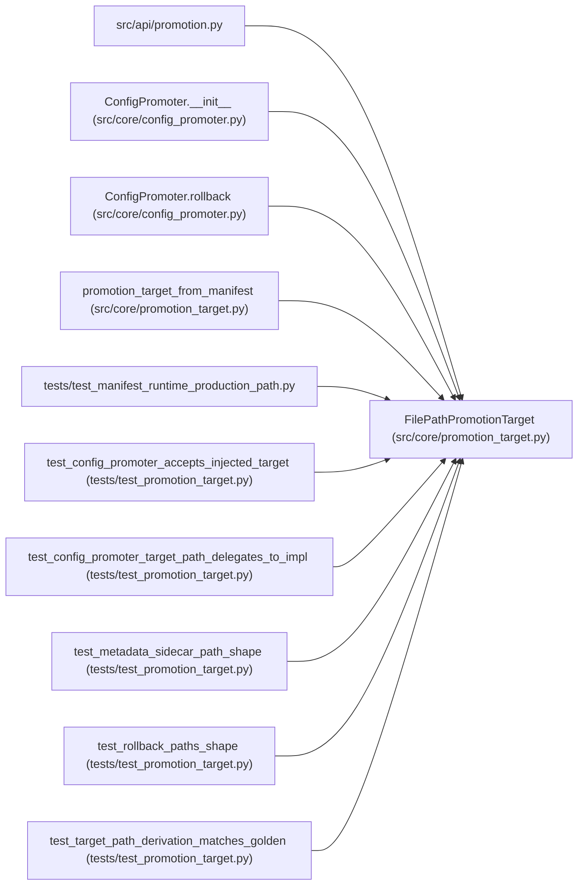

# FilePathPromotionTarget

**Location:** `src/core/promotion_target.py:148`
**Kind:** Class
**Bases:** —
**Module:** [promotion_target](../modules/promotion_target.md)

## Description

Write promoted configs to the host filesystem (ARC-011 P1-016).

The single concrete ``PromotionTarget`` today. All methods are extracted
verbatim from the ``ConfigPromoter`` ``@staticmethod`` / module-level
helpers; behavior is identical. Future targets (e.g. a git-ops target, an
object-store target) will implement the same protocol.

ARC-012 P7-007/D4: when constructed with the skill's declared
``path_template``, ``target_path`` renders it (closed placeholder set,
sanitized request-supplied segments). A relative template resolves under
the host-configs root; an absolute one (the G6 loader resolves
``{settings.host_configs_path}`` before validation) is taken as-is.
Without a template the incumbent generic layout applies, with the D1
slug rule: the path segment is the legacy ``model_type`` alias when one
exists, else the ``skill_id`` — never the literal ``"skill"``.

## Attributes

*No annotated attributes found.*

## Methods

| Method | Signature | Decorators | Description |
|--------|-----------|------------|-------------|
| `__init__` | `(*, path_template: Optional[str] = None) -> None` | — | — |
| `path_template` | `() -> Optional[str]` | `@property` | — |
| `target_path` | `(*, model_type: str, instrument: str, timeframe: str, skill_id: str = '') -> str` | — | Determine the host config file path for promotion. |
| `metadata_sidecar_path` | `(target_path: str, iteration: int, *, scope: str = 'development') -> str` | — | Moved verbatim from ``ConfigPromoter._metadata_sidecar_path``. |
| `rollback_snapshot_path` | `(*, target_path: str, research_id: str, iteration: int) -> str` | — | Moved verbatim from ``ConfigPromoter._rollback_snapshot_path``. |
| `rollback_metadata_sidecar_path` | `(target_path: str, promotion_id: int) -> str` | — | Moved verbatim from ``ConfigPromoter._rollback_metadata_sidecar_path``. |
| `write` | *(async)* `(path: str, content: str) -> None` | — | Atomic write: tmp file → fsync → os.replace. |

## Relationships

<!-- Auto-generated relationship summary. Do not edit by hand. -->

### Summary

| Module | Methods | Attributes |
|---|---:|---|
| [promotion_target](../modules/promotion_target.md) | 7 | — |

### References

| Reference | Kind | Source | Call sites |
|---|---|---|---:|
| `promotion` | import | [promotion](../modules/promotion.md) | — |
| `ConfigPromoter.__init__` | call | [config_promoter](../modules/config_promoter.md) | 1 |
| `ConfigPromoter.rollback` | call | [config_promoter](../modules/config_promoter.md) | 2 |
| `promotion_target_from_manifest` | call | [promotion_target](../modules/promotion_target.md) | 1 |
| `test_manifest_runtime_production_path` | import | [test_manifest_runtime_production_path](../modules/test_manifest_runtime_production_path.md) | — |
| `test_config_promoter_accepts_injected_target` | call | [test_promotion_target](../modules/test_promotion_target.md) | 1 |
| `test_config_promoter_target_path_delegates_to_impl` | call | [test_promotion_target](../modules/test_promotion_target.md) | 1 |
| `test_metadata_sidecar_path_shape` | call | [test_promotion_target](../modules/test_promotion_target.md) | 1 |
| `test_rollback_paths_shape` | call | [test_promotion_target](../modules/test_promotion_target.md) | 1 |
| `test_target_path_derivation_matches_golden` | call | [test_promotion_target](../modules/test_promotion_target.md) | 1 |
