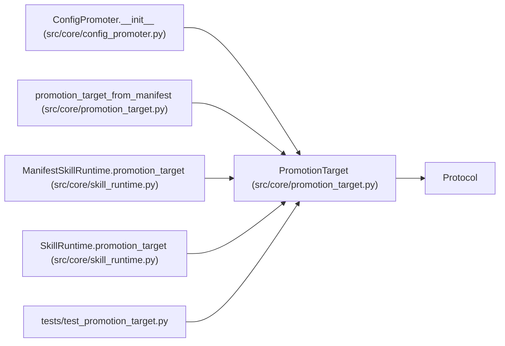

# PromotionTarget

**Location:** `src/core/promotion_target.py:56`
**Kind:** Class
**Bases:** `Protocol`
**Module:** [promotion_target](../modules/promotion_target.md)

## Description

Where a promoted config is written and how its path is derived
(ARC-011 P1-015).

A concrete target (``FilePathPromotionTarget`` in P1-016) implements this
surface. ``ConfigPromoter`` (P1-017) is wired to accept any
``PromotionTarget`` and delegates the file writes to it while keeping the
gate-evaluation logic (``preview`` / ``confirm`` / ``rollback``).

## Attributes

*No annotated attributes found.*

## Methods

| Method | Signature | Decorators | Description |
|--------|-----------|------------|-------------|
| `target_path` | `(*, model_type: str, instrument: str, timeframe: str, skill_id: str = '') -> str` | — | Derive the host config file path for a promoted config. |
| `metadata_sidecar_path` | `(target_path: str, iteration: int, *, scope: str = 'development') -> str` | — | Derive the JSON sidecar path recording this promotion's metadata. |
| `rollback_snapshot_path` | `(*, target_path: str, research_id: str, iteration: int) -> str` | — | Derive the path of the pre-promotion YAML snapshot used for rollback. |
| `rollback_metadata_sidecar_path` | `(target_path: str, promotion_id: int) -> str` | — | Derive the JSON sidecar path recording a rollback's metadata. |
| `write` | *(async)* `(path: str, content: str) -> None` | — | Atomically write ``content`` to ``path`` (tmp → fsync → os.replace). |

## Relationships

<!-- Auto-generated relationship summary. Do not edit by hand. -->

### Summary

| Module | Methods | Attributes |
|---|---:|---|
| [promotion_target](../modules/promotion_target.md) | 5 | — |

### Structure

| Kind | Entity | Module |
|---|---|---|
| Base | `Protocol` | — |

### References

| Reference | Kind | Source | Call sites |
|---|---|---|---:|
| `ConfigPromoter.__init__` | type_reference | [config_promoter](../modules/config_promoter.md) | — |
| `promotion_target_from_manifest` | type_reference | [promotion_target](../modules/promotion_target.md) | — |
| `ManifestSkillRuntime.promotion_target` | type_reference | [skill_runtime](../modules/skill_runtime.md) | — |
| `SkillRuntime.promotion_target` | type_reference | [skill_runtime](../modules/skill_runtime.md) | — |
| `test_promotion_target` | import | [test_promotion_target](../modules/test_promotion_target.md) | — |
