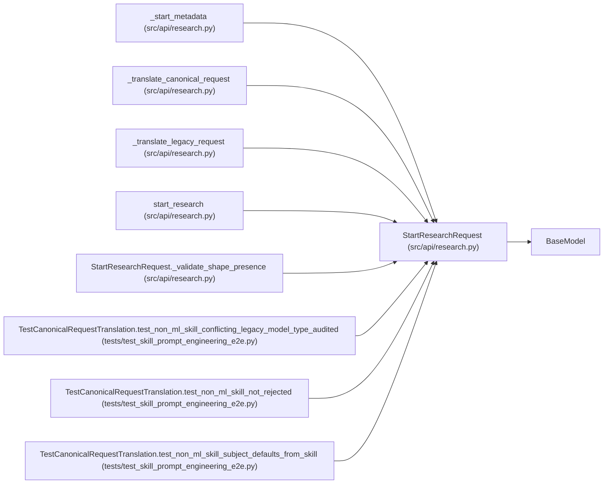

# StartResearchRequest

**Location:** `src/api/research.py:521`
**Kind:** Pydantic model
**Bases:** `BaseModel`
**Module:** [research](../modules/research.md)

## Description

_Auto-generated from `StartResearchRequest` in `src/api/research.py`._

## Validators

| Method | Scope | Fields | Mode | Options |
|--------|-------|--------|------|---------|
| `_validate_shape_presence` | model | — | after | — |

## Attributes

| Name | Type | Wire name | Required | Nullable | Default | Constraints | Examples | Description |
|------|------|-----------|----------|----------|---------|-------------|-------------|----------|
| `instrument` | `Optional[str]` | `instrument` | No | Yes | `None` | — | 'subject-a' | — |
| `timeframe` | `Optional[str]` | `timeframe` | No | Yes | `None` | — | 'v1' | — |
| `model_type` | `Optional[str]` | `model_type` | No | Yes | `None` | — | — | Legacy alias for skill_id. Known legacy short names (direction/volatility/rl) map to their canonical skill ids; any other value is used as the skill_id directly. Unknown skills are rejected with 404 skill_not_found. In responses this is a derived legacy alias: the trio for ML skills, or "" for skills without one — never a skill id. |
| `skill_id` | `Optional[str]` | `skill_id` | No | Yes | `None` | — | 'ml-direction' | — |
| `subject_id` | `Optional[str]` | `subject_id` | No | Yes | `None` | — | 'DOGE_USDT' | — |
| `variant` | `Optional[str]` | `variant` | No | Yes | `None` | — | '15m' | — |
| `skill_params` | `Optional[Dict[str, Any]]` | `skill_params` | No | Yes | `None` | — | — | Canonical skill parameters, validated against the skill's param_schema. Sent alongside skill_id; ignored for legacy shape. |
| `tag` | `Optional[str]` | `tag` | No | Yes | `None` | — | 'doge-apr01' | — |
| `quick_mode` | `Optional[bool]` | `quick_mode` | No | Yes | `None` | — | — | If null, uses server default (standard/full mode) |
| `max_iterations` | `Optional[int]` | `max_iterations` | No | Yes | `None` | ge=1; le=500 | — | — |
| `max_budget_usd` | `Optional[float]` | `max_budget_usd` | No | Yes | `None` | ge=0.1; le=500.0 | — | — |
| `timeout_minutes` | `Optional[int]` | `timeout_minutes` | No | Yes | `None` | ge=30; le=1440 | — | Session timeout in minutes (default: server setting, typically 120) |
| `focus_hint` | `Optional[str]` | `focus_hint` | No | Yes | `None` | max_length=1000 | — | Optional hint for the agent about what to focus on |
| `manifest` | `Optional[Dict[str, Any]]` | `manifest` | No | Yes | `None` | — | — | Optional research-session manifest overrides. Immutable identity fields must still match the server-generated session. |

## Methods

| Method | Signature | Decorators | Description |
|--------|-----------|------------|-------------|
| `_validate_shape_presence` | `() -> 'StartResearchRequest'` | `@model_validator(mode='after')` | P3-013: at least one request shape must be present — either the |

## Relationships

<!-- Auto-generated relationship summary. Do not edit by hand. -->

### Summary

| Module | Methods | Attributes |
|---|---:|---|
| [research](../modules/research.md) | 1 | `focus_hint`, `instrument`, `manifest`, `max_budget_usd`, `max_iterations`, `model_type`, `quick_mode`, `skill_id`, `skill_params`, `subject_id`, `tag`, `timeframe` |

### Structure

| Kind | Entity | Module |
|---|---|---|
| Base | `BaseModel` | — |

### References

| Reference | Kind | Source | Call sites |
|---|---|---|---:|
| `_start_metadata` | type_reference | [research](../modules/research.md) | — |
| `_translate_canonical_request` | type_reference | [research](../modules/research.md) | — |
| `_translate_legacy_request` | type_reference | [research](../modules/research.md) | — |
| `start_research` | type_reference | [research](../modules/research.md) | — |
| `StartResearchRequest._validate_shape_presence` | type_reference | [research](../modules/research.md) | — |
| `TestCanonicalRequestTranslation.test_non_ml_skill_conflicting_legacy_model_type_audited` | call | [test_skill_prompt_engineering_e2e](../modules/test_skill_prompt_engineering_e2e.md) | 1 |
| `TestCanonicalRequestTranslation.test_non_ml_skill_not_rejected` | call | [test_skill_prompt_engineering_e2e](../modules/test_skill_prompt_engineering_e2e.md) | 1 |
| `TestCanonicalRequestTranslation.test_non_ml_skill_subject_defaults_from_skill` | call | [test_skill_prompt_engineering_e2e](../modules/test_skill_prompt_engineering_e2e.md) | 1 |
