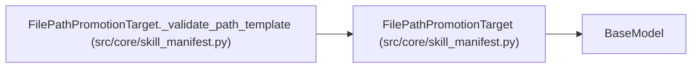

# FilePathPromotionTarget

**Location:** `src/core/skill_manifest.py:656`
**Kind:** Pydantic model
**Bases:** `BaseModel`
**Module:** [skill_manifest](../modules/skill_manifest.md)

## Description

``kind: file_path`` — write a config file to the host bind mount
(P1-015 ``FilePathPromotionTarget``).

## Model Configuration

| Setting | Value | Source |
|---------|-------|--------|
| `extra` | `'forbid'` | model_config |

## Validators

| Method | Scope | Fields | Mode | Options |
|--------|-------|--------|------|---------|
| `_validate_path_template` | model | — | after | — |

## Attributes

| Name | Type | Wire name | Required | Nullable | Default | Constraints | Examples | Description |
|------|------|-----------|----------|----------|---------|-------------|-------------|----------|
| `kind` | `Literal['file_path']` | `kind` | No | No | `'file_path'` | — | — | — |
| `path_template` | `str` | `path_template` | Yes | No | — | — | — | — |
| `sidecar_extensions` | `list[str]` | `sidecar_extensions` | No | No | factory: `list` | — | — | — |
| `rollback_template` | `Optional[str]` | `rollback_template` | No | Yes | `None` | — | — | — |
| `atomic_write` | `bool` | `atomic_write` | No | No | `True` | — | — | — |

## Methods

| Method | Signature | Decorators | Description |
|--------|-----------|------------|-------------|
| `_validate_path_template` | `() -> 'FilePathPromotionTarget'` | `@model_validator(mode='after')` | — |

## Relationships

<!-- Auto-generated relationship summary. Do not edit by hand. -->

### Summary

| Module | Methods | Attributes |
|---|---:|---|
| [skill_manifest](../modules/skill_manifest.md) | 1 | `atomic_write`, `kind`, `path_template`, `rollback_template`, `sidecar_extensions` |

### Structure

| Kind | Entity | Module |
|---|---|---|
| Base | `BaseModel` | — |

### References

| Reference | Kind | Source | Call sites |
|---|---|---|---:|
| `FilePathPromotionTarget._validate_path_template` | type_reference | [skill_manifest](../modules/skill_manifest.md) | — |
