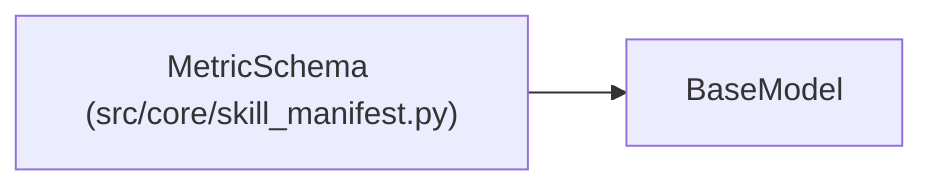

# MetricSchema

**Location:** `src/core/skill_manifest.py:289`
**Kind:** Pydantic model
**Bases:** `BaseModel`
**Module:** [skill_manifest](../modules/skill_manifest.md)

## Description

Metric presentation + semantics (ARC-011 §9 ``metric_schema``).

## Model Configuration

| Setting | Value | Source |
|---------|-------|--------|
| `extra` | `'forbid'` | model_config |

## Attributes

| Name | Type | Wire name | Required | Nullable | Default | Constraints | Examples | Description |
|------|------|-----------|----------|----------|---------|-------------|-------------|----------|
| `primary` | `PrimaryMetric` | `primary` | Yes | No | — | — | — | — |
| `gates` | `list[MetricColumn]` | `gates` | No | No | factory: `list` | — | — | — |
| `chart_series` | `list[MetricColumn]` | `chart_series` | No | No | factory: `list` | — | — | — |
| `iteration_table_columns` | `list[MetricColumn]` | `iteration_table_columns` | No | No | factory: `list` | — | — | — |
| `goal` | `MetricGoal` | `goal` | No | No | `'optimize'` | — | — | — |
| `satisfice_threshold_field` | `Optional[str]` | `satisfice_threshold_field` | No | Yes | `None` | — | — | Boolean field gating satisfice completion (G11). |
| `significance` | `Optional[SignificanceConfig]` | `significance` | No | Yes | `None` | — | — | — |

## Methods

*No public methods. Inherits from base classes.*

## Relationships

<!-- Auto-generated relationship summary. Do not edit by hand. -->

### Summary

| Module | Methods | Attributes |
|---|---:|---|
| [skill_manifest](../modules/skill_manifest.md) | 0 | `chart_series`, `gates`, `goal`, `iteration_table_columns`, `primary`, `satisfice_threshold_field`, `significance` |

### Structure

| Kind | Entity | Module |
|---|---|---|
| Base | `BaseModel` | — |
