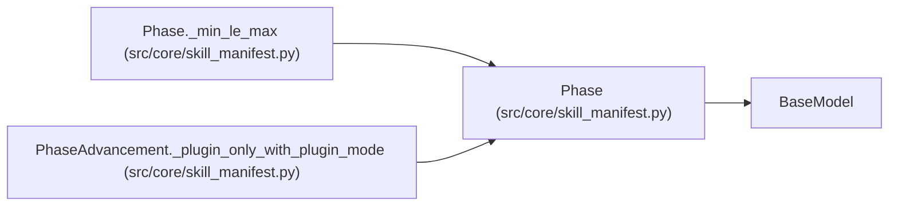

# Phase

**Location:** `src/core/skill_manifest.py:344`
**Kind:** Pydantic model
**Bases:** `BaseModel`
**Module:** [skill_manifest](../modules/skill_manifest.md)

## Description

One phase in the research playbook (ARC-011 §9 ``phase_plan[]``).
Literals reproduce the incumbent ``DIRECTION_PHASES`` etc. verbatim.

## Model Configuration

| Setting | Value | Source |
|---------|-------|--------|
| `extra` | `'forbid'` | model_config |

## Validators

| Method | Scope | Fields | Mode | Options |
|--------|-------|--------|------|---------|
| `_min_le_max` | model | — | after | — |

## Attributes

| Name | Type | Wire name | Required | Nullable | Default | Constraints | Examples | Description |
|------|------|-----------|----------|----------|---------|-------------|-------------|----------|
| `id` | `str` | `id` | Yes | No | — | — | — | — |
| `label` | `Optional[str]` | `label` | No | Yes | `None` | — | — | — |
| `min_iterations` | `int` | `min_iterations` | Yes | No | — | ge=0 | — | — |
| `max_iterations` | `int` | `max_iterations` | Yes | No | — | ge=0 | — | — |
| `evidence_keys` | `list[str]` | `evidence_keys` | No | No | factory: `list` | — | — | — |
| `next_action` | `Optional[str]` | `next_action` | No | Yes | `None` | — | — | — |
| `stagnation_exempt` | `bool` | `stagnation_exempt` | No | No | `False` | — | — | — |
| `advancement` | `Optional[PhaseAdvancementOverride]` | `advancement` | No | Yes | `None` | — | — | — |

## Methods

| Method | Signature | Decorators | Description |
|--------|-----------|------------|-------------|
| `_min_le_max` | `() -> 'Phase'` | `@model_validator(mode='after')` | — |

## Relationships

<!-- Auto-generated relationship summary. Do not edit by hand. -->

### Summary

| Module | Methods | Attributes |
|---|---:|---|
| [skill_manifest](../modules/skill_manifest.md) | 1 | `advancement`, `evidence_keys`, `id`, `label`, `max_iterations`, `min_iterations`, `next_action`, `stagnation_exempt` |

### Structure

| Kind | Entity | Module |
|---|---|---|
| Base | `BaseModel` | — |

### References

| Reference | Kind | Source | Call sites |
|---|---|---|---:|
| `Phase._min_le_max` | type_reference | [skill_manifest](../modules/skill_manifest.md) | — |
| `PhaseAdvancement._plugin_only_with_plugin_mode` | type_reference | [skill_manifest](../modules/skill_manifest.md) | — |
