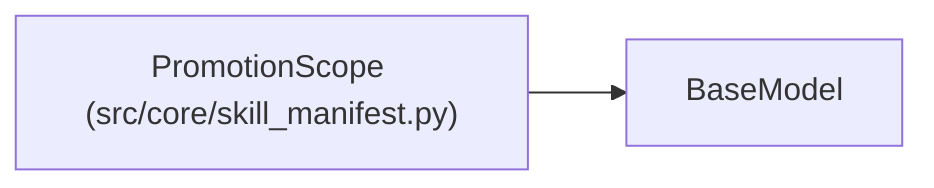

# PromotionScope

**Location:** `src/core/skill_manifest.py:624`
**Kind:** Pydantic model
**Bases:** `BaseModel`
**Module:** [skill_manifest](../modules/skill_manifest.md)

## Description

One promotion scope declaration (ARC-011 §9 ``promotion_target.scopes``).

## Model Configuration

| Setting | Value | Source |
|---------|-------|--------|
| `extra` | `'allow'` | model_config |

## Attributes

| Name | Type | Wire name | Required | Nullable | Default | Constraints | Examples | Description |
|------|------|-----------|----------|----------|---------|-------------|-------------|----------|
| `id` | `str` | `id` | Yes | No | — | — | — | — |
| `approval_required` | `bool` | `approval_required` | No | No | `False` | — | — | — |
| `prior_scopes` | `list[str]` | `prior_scopes` | No | No | factory: `list` | — | — | — |

## Methods

*No public methods. Inherits from base classes.*

## Relationships

<!-- Auto-generated relationship summary. Do not edit by hand. -->

### Summary

| Module | Methods | Attributes |
|---|---:|---|
| [skill_manifest](../modules/skill_manifest.md) | 0 | `approval_required`, `id`, `prior_scopes` |

### Structure

| Kind | Entity | Module |
|---|---|---|
| Base | `BaseModel` | — |
