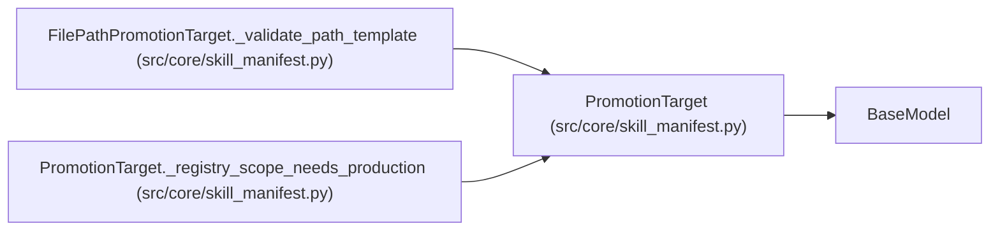

# PromotionTarget

**Location:** `src/core/skill_manifest.py:755`
**Kind:** Pydantic model
**Bases:** `BaseModel`
**Module:** [skill_manifest](../modules/skill_manifest.md)

## Description

Promotion surface (ARC-011 §9 ``promotion_target``). ``primary`` is the
default-scope (development) target; ``gate_bundles`` (G4) and ``scopes``
describe the higher-scope chain.

## Model Configuration

| Setting | Value | Source |
|---------|-------|--------|
| `extra` | `'forbid'` | model_config |

## Validators

| Method | Scope | Fields | Mode | Options |
|--------|-------|--------|------|---------|
| `_registry_scope_needs_production` | model | — | after | — |

## Attributes

| Name | Type | Wire name | Required | Nullable | Default | Constraints | Examples | Description |
|------|------|-----------|----------|----------|---------|-------------|-------------|----------|
| `primary` | `PromotionTargetKind` | `primary` | Yes | No | — | discriminator='kind' | — | — |
| `gate_bundles` | `Optional[GateBundles]` | `gate_bundles` | No | Yes | `None` | — | — | — |
| `scopes` | `list[PromotionScope]` | `scopes` | No | No | factory: `list` | — | — | — |

## Methods

| Method | Signature | Decorators | Description |
|--------|-----------|------------|-------------|
| `_registry_scope_needs_production` | `() -> 'PromotionTarget'` | `@model_validator(mode='after')` | — |

## Relationships

<!-- Auto-generated relationship summary. Do not edit by hand. -->

### Summary

| Module | Methods | Attributes |
|---|---:|---|
| [skill_manifest](../modules/skill_manifest.md) | 1 | `gate_bundles`, `primary`, `scopes` |

### Structure

| Kind | Entity | Module |
|---|---|---|
| Base | `BaseModel` | — |

### References

| Reference | Kind | Source | Call sites |
|---|---|---|---:|
| `FilePathPromotionTarget._validate_path_template` | type_reference | [skill_manifest](../modules/skill_manifest.md) | — |
| `PromotionTarget._registry_scope_needs_production` | type_reference | [skill_manifest](../modules/skill_manifest.md) | — |
