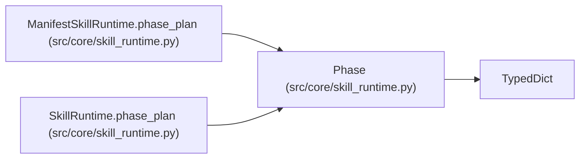

# Phase

**Location:** `src/core/skill_runtime.py:142`
**Kind:** Class
**Bases:** `TypedDict`
**Module:** [skill_runtime](../modules/skill_runtime.md)

## Description

Alias over the phase dict shape in ``research_phase_plan.py``
(``DIRECTION_PHASES`` / ``VOLATILITY_PHASES`` / ``FALLBACK_PHASES``):
``id``, ``label``, ``next_action``, ``min_iterations``, ``max_iterations``.

## Attributes

| Name | Type | Presence | Description |
|------|------|----------|-------------|
| `id` | `str` | *optional* | — |
| `label` | `str` | *optional* | — |
| `next_action` | `str` | *optional* | — |
| `min_iterations` | `int` | *optional* | — |
| `max_iterations` | `int` | *optional* | — |
| `evidence_keys` | `tuple[str, ...]` | *optional* | — |
| `stagnation_exempt` | `bool` | *optional* | — |

## Methods

*No public methods. Inherits from base classes.*

## Relationships

<!-- Auto-generated relationship summary. Do not edit by hand. -->

### Summary

| Module | Methods | Attributes |
|---|---:|---|
| [skill_runtime](../modules/skill_runtime.md) | 0 | `evidence_keys`, `id`, `label`, `max_iterations`, `min_iterations`, `next_action`, `stagnation_exempt` |

### Structure

| Kind | Entity | Module |
|---|---|---|
| Base | `TypedDict` | — |

### References

| Reference | Kind | Source | Call sites |
|---|---|---|---:|
| `ManifestSkillRuntime.phase_plan` | type_reference | [skill_runtime](../modules/skill_runtime.md) | — |
| `SkillRuntime.phase_plan` | type_reference | [skill_runtime](../modules/skill_runtime.md) | — |
