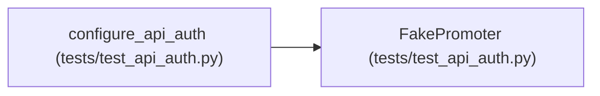

# FakePromoter

**Location:** `tests/test_api_auth.py:219`
**Kind:** Class
**Bases:** —
**Module:** [test_api_auth](../modules/test_api_auth.md)

## Description

_Auto-generated from `FakePromoter` in `tests/test_api_auth.py`._

## Attributes

*No annotated attributes found.*

## Methods

| Method | Signature | Decorators | Description |
|--------|-----------|------------|-------------|
| `preview` | *(async)* `(research_id: str, **kwargs)` | — | — |
| `confirm` | *(async)* `(research_id: str, **kwargs)` | — | — |
| `rollback` | *(async)* `(*, model_type: str, instrument: str, timeframe: str, reason: str \| None = None, reconcile_legacy: bool = False)` | — | — |

## Relationships

<!-- Auto-generated relationship summary. Do not edit by hand. -->

### Summary

| Module | Methods | Attributes |
|---|---:|---|
| [test_api_auth](../modules/test_api_auth.md) | 3 | — |

### References

| Reference | Kind | Source | Call sites |
|---|---|---|---:|
| `configure_api_auth` | call | [test_api_auth](../modules/test_api_auth.md) | 1 |
