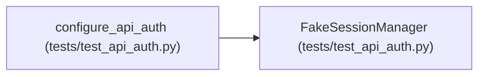

# FakeSessionManager

**Location:** `tests/test_api_auth.py:55`
**Kind:** Class
**Bases:** —
**Module:** [test_api_auth](../modules/test_api_auth.md)

## Description

_Auto-generated from `FakeSessionManager` in `tests/test_api_auth.py`._

## Attributes

| Name | Type | Default | Description |
|------|------|---------|-------------|
| `_active_pipelines` | `dict[str, object]` | `{}` | — |

## Methods

| Method | Signature | Decorators | Description |
|--------|-----------|------------|-------------|
| `start_session` | *(async)* `(**kwargs)` | — | — |
| `start_pipeline` | *(async)* `(**kwargs)` | — | — |
| `stop_session` | *(async)* `(research_id: str)` | — | — |
| `stop_pipeline` | *(async)* `(pipeline_id: str)` | — | — |
| `pause_session` | *(async)* `(research_id: str)` | — | — |
| `resume_session` | *(async)* `(research_id: str)` | — | — |
| `continue_session` | *(async)* `(research_id: str, **kwargs)` | — | — |
| `resume_interrupted_session` | *(async)* `(research_id: str, **kwargs)` | — | — |
| `continue_pipeline` | *(async)* `(pipeline_id: str, **kwargs)` | — | — |
| `is_running` | `(research_id: str)` | — | — |

## Relationships

<!-- Auto-generated relationship summary. Do not edit by hand. -->

### Summary

| Module | Methods | Attributes |
|---|---:|---|
| [test_api_auth](../modules/test_api_auth.md) | 10 | `_active_pipelines` |

### References

| Reference | Kind | Source | Call sites |
|---|---|---|---:|
| `configure_api_auth` | call | [test_api_auth](../modules/test_api_auth.md) | 1 |
