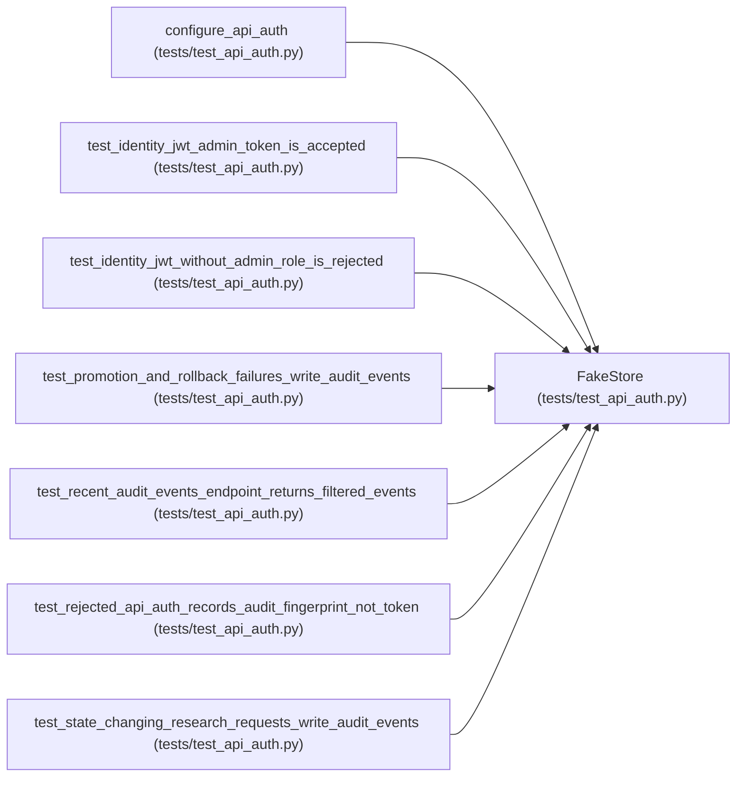

# FakeStore

**Location:** `tests/test_api_auth.py:90`
**Kind:** Class
**Bases:** —
**Module:** [test_api_auth](../modules/test_api_auth.md)

## Description

_Auto-generated from `FakeStore` in `tests/test_api_auth.py`._

## Attributes

*No annotated attributes found.*

## Methods

| Method | Signature | Decorators | Description |
|--------|-----------|------------|-------------|
| `__init__` | `() -> None` | — | — |
| `list_sessions` | *(async)* `(**kwargs)` | — | — |
| `count_sessions` | *(async)* `(**kwargs)` | — | — |
| `get_pipeline` | *(async)* `(pipeline_id: str)` | — | — |
| `get_session` | *(async)* `(research_id: str)` | — | — |
| `get_iterations` | *(async)* `(research_id: str)` | — | — |
| `get_best_iteration` | *(async)* `(research_id: str)` | — | — |
| `get_hpo_studies` | *(async)* `(research_id: str)` | — | — |
| `get_planned_trials` | *(async)* `(research_id: str)` | — | — |
| `list_promotions` | *(async)* `()` | — | — |
| `list_pipelines` | *(async)* `(**kwargs)` | — | — |
| `delete_session` | *(async)* `(research_id: str)` | — | — |
| `record_audit_event` | *(async)* `(**kwargs)` | — | — |
| `begin_idempotency_record` | *(async)* `(*, operation: str, parent_id: str, key_hash: str, request_hash: str)` | — | — |
| `complete_idempotency_record` | *(async)* `(*, operation: str, parent_id: str, key_hash: str, child_id: str \| None, response: dict)` | — | — |
| `delete_idempotency_record` | *(async)* `(*, operation: str, parent_id: str, key_hash: str)` | — | — |
| `list_audit_events` | *(async)* `(*, limit: int = 100, action: str \| None = None, research_id: str \| None = None, pipeline_id: str \| None = None)` | — | — |

## Relationships

<!-- Auto-generated relationship summary. Do not edit by hand. -->

### Summary

| Module | Methods | Attributes |
|---|---:|---|
| [test_api_auth](../modules/test_api_auth.md) | 17 | — |

### References

| Reference | Kind | Source | Call sites |
|---|---|---|---:|
| `configure_api_auth` | call | [test_api_auth](../modules/test_api_auth.md) | 1 |
| `test_identity_jwt_admin_token_is_accepted` | type_reference | [test_api_auth](../modules/test_api_auth.md) | — |
| `test_identity_jwt_without_admin_role_is_rejected` | type_reference | [test_api_auth](../modules/test_api_auth.md) | — |
| `test_promotion_and_rollback_failures_write_audit_events` | type_reference | [test_api_auth](../modules/test_api_auth.md) | — |
| `test_recent_audit_events_endpoint_returns_filtered_events` | type_reference | [test_api_auth](../modules/test_api_auth.md) | — |
| `test_rejected_api_auth_records_audit_fingerprint_not_token` | type_reference | [test_api_auth](../modules/test_api_auth.md) | — |
| `test_state_changing_research_requests_write_audit_events` | type_reference | [test_api_auth](../modules/test_api_auth.md) | — |
