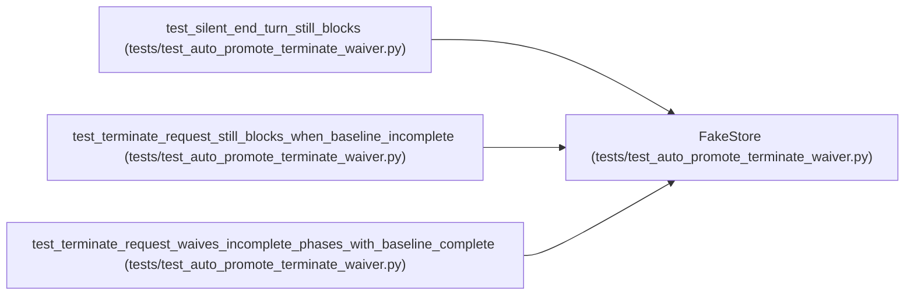

# FakeStore

**Location:** `tests/test_auto_promote_terminate_waiver.py:55`
**Kind:** Class
**Bases:** —
**Module:** [test_auto_promote_terminate_waiver](../modules/test_auto_promote_terminate_waiver.md)

## Description

_Auto-generated from `FakeStore` in `tests/test_auto_promote_terminate_waiver.py`._

## Attributes

*No annotated attributes found.*

## Methods

| Method | Signature | Decorators | Description |
|--------|-----------|------------|-------------|
| `__init__` | `(*, phase_state: Dict[str, Any], terminal_reason: Optional[str] = None, terminate_request_received: bool = False) -> None` | — | — |
| `get_session` | *(async)* `(research_id: str) -> Dict[str, Any]` | — | — |
| `get_iterations` | *(async)* `(research_id: str) -> List[Dict[str, Any]]` | — | — |
| `get_hpo_studies` | *(async)* `(research_id: str) -> List[Dict[str, Any]]` | — | — |
| `list_promotions` | *(async)* `() -> List[Dict[str, Any]]` | — | — |
| `record_audit_event` | *(async)* `(**kwargs: Any) -> Dict[str, Any]` | — | — |

## Relationships

<!-- Auto-generated relationship summary. Do not edit by hand. -->

### Summary

| Module | Methods | Attributes |
|---|---:|---|
| [test_auto_promote_terminate_waiver](../modules/test_auto_promote_terminate_waiver.md) | 6 | — |

### References

| Reference | Kind | Source | Call sites |
|---|---|---|---:|
| `test_silent_end_turn_still_blocks` | call | [test_auto_promote_terminate_waiver](../modules/test_auto_promote_terminate_waiver.md) | 1 |
| `test_terminate_request_still_blocks_when_baseline_incomplete` | call | [test_auto_promote_terminate_waiver](../modules/test_auto_promote_terminate_waiver.md) | 1 |
| `test_terminate_request_waives_incomplete_phases_with_baseline_complete` | call | [test_auto_promote_terminate_waiver](../modules/test_auto_promote_terminate_waiver.md) | 1 |
